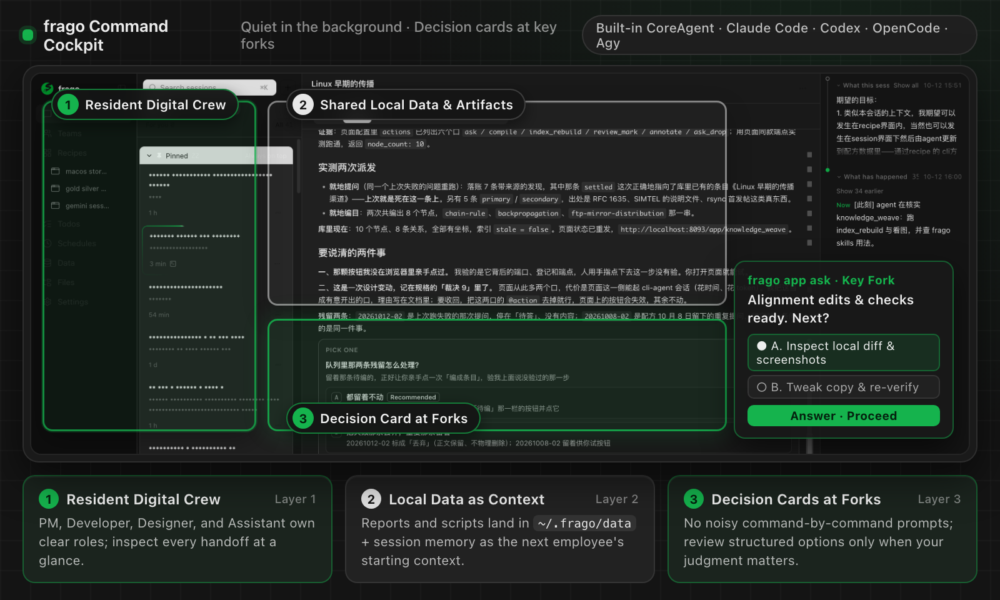
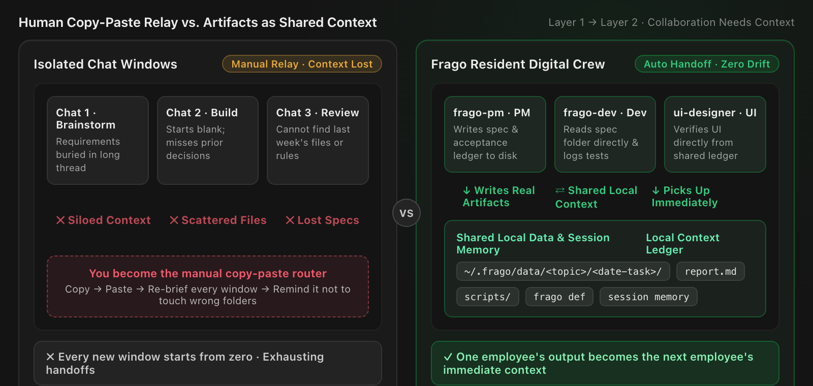
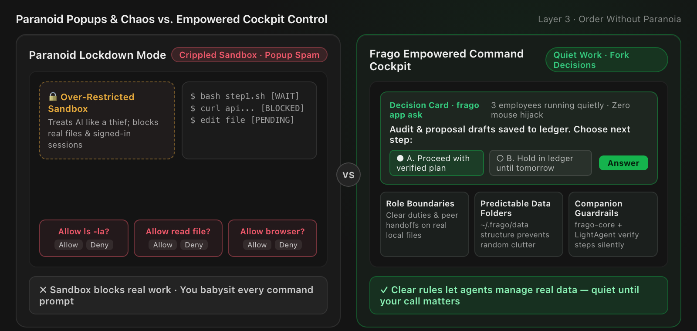

<div align="center">


# frago

**Not another chat window. A digital crew on your own computer.**

Role-based digital employees — PM, Developer, Designer, Analyst, Assistant — working together on your machine. With clear workspace rules instead of paranoid sandboxes, your crew **directly manages your local data and session history as shared context**; what one employee produces becomes the starting point for the next. They work quietly in the background without stealing your mouse, and hand you a decision card only when your call is needed.

**Battle-tested across tens of thousands of real sessions on dozens of users' machines · macOS / Windows / Linux**

English · [简体中文](README.zh-CN.md) · [**30-Sec Install**](#get-started-in-30-seconds) · [frago.ai](https://www.frago.ai) · [User Guide](docs/user-guide.md) · [Discussions](https://github.com/tsaijamey/frago/discussions)



</div>

---

## Why a single chat window can't handle real work

1. **Real work takes a team, not one chat box.**
   One chat thread breaks down on long projects. In frago, specialized digital employees own clear roles and ledgers, handing off work automatically without you babysitting the screen.
2. **To collaborate, digital employees need shared context.**
   If you have to copy-paste between windows, you are the bottleneck. In frago, the local files, reports, scripts, and session history left by one employee become the immediate context for the next.
3. **Clear rules let agents manage real data — not paranoia.**
   Most tools constantly suspect AI will wipe your drive, trapping it in crippled sandboxes or endless permission popups. frago enforces role boundaries, predictable data folders (`~/.frago/data`), and companion guardrails so you can confidently let agents manage your local data.

---

## At a Glance: Temporary Chat Windows vs. A Resident Digital Crew

### 1. Human Copy-Paste Relay vs. Artifacts as Shared Context

<p align="center"></p>

### 2. Paranoid Popups & Terminal Chaos vs. Empowered Control in One Cockpit

<p align="center"></p>

---

## Four Pillars Behind Your Digital Crew (Click to expand)

<details>
<summary><b>1. Role-Based Digital Employees & Swappable Brains</b></summary>
<br>
Each digital employee has a defined role, dedicated data ledger, and automatic peer-handoff rules. frago ships with a built-in execution engine (<b>CoreAgent</b>) out of the box, and also lets you bind roles to <b>Claude Code</b>, <b>Codex</b>, <b>OpenCode</b>, or <b>Antigravity (agy)</b>. Switch models anytime without losing your team structure or local data.
</details>

<details>
<summary><b>2. Direct Local Data Management: 4-Layer Context & Companion Rules</b></summary>
<br>
<ul>
<li><b>Artifact Ledger</b> (<code>~/.frago/data/&lt;topic&gt;/&lt;date-task&gt;/</code>): Reports, scripts, and notes land in predictable folders so the next employee picks up with zero re-briefing;</li>
<li><b>Domain Knowledge</b> (<code>frago def</code>): Hard-won lessons and constraints are saved on the fly and recalled automatically on future tasks;</li>
<li><b>Session Memory</b> (<code>frago session search / ask</code>): Search across tens of thousands of past sessions and query previous contexts directly;</li>
<li><b>Companion Guardrails</b> (<code>frago-core</code> + <code>LightAgent</code>): Automatically verify folder rules, role boundaries, and delivery quality — giving you confidence without paranoid sandboxing.</li>
</ul>
</details>

<details>
<summary><b>3. Two Non-Intrusive Workspaces: Signed-In Browser + Background Virtual Desktop</b></summary>
<br>
<ul>
<li><b>Signed-In Browser Tabs</b> (<code>frago browser</code>): Reuse your already logged-in browser profile without re-authenticating; each employee works in its own color-coded tab group without hijacking your active tab.</li>
<li><b>Background Virtual Desktop</b> (<code>frago desktop</code>): Long GUI tasks and screen recordings run on an isolated background screen while you keep typing in the foreground; take over in one click only when a captcha requires you.</li>
</ul>
</details>

<details>
<summary><b>4. Decision Cards at Key Forks + Zero-Token Deterministic Recipes</b></summary>
<br>
<ul>
<li><b>Decision Cards</b> (<code>frago app ask</code>): No noisy command-by-command prompts. Employees surface a structured choice card only when options are ready and a business decision matters.</li>
<li><b>Zero-Token Recipes</b> (<code>frago recipe</code>): Once an employee figures out a workflow (daily briefings, cross-site collection, media processing, dashboards), freeze it into deterministic code that re-runs at <b>0 token cost with zero drift</b>.</li>
</ul>
</details>

---

## Get Started in 30 Seconds

**No manual environment setup or prior CLI agent required.**
One command sets up everything (including the built-in CoreAgent) and opens your Command Cockpit at `http://127.0.0.1:8093`.

### Option 1: One-Line Automatic Install (Recommended)

**macOS / Linux (Paste in Terminal):**
```bash
curl -fsSL https://frago.ai/install.sh | bash
```

**Windows (Paste in PowerShell):**
```powershell
irm https://frago.ai/install.ps1 | iex
```

### Option 2: Let Claude Code / Codex Install It for You

```text
/plugin marketplace add tsaijamey/how-to-install-frago
/plugin install how-to-install-frago@how-to-install-frago
```
Then simply tell your agent: **Install frago for me** (see [how-to-install-frago](https://github.com/tsaijamey/how-to-install-frago)).

<details>
<summary><b>Manual Install / Developer Setup (PyPI & Source)</b></summary>
<br>
Requires Python 3.13+:
```bash
uv tool install frago-cli   # Install CLI and Web Cockpit
frago init                  # Check dependencies and initialize config
frago server start          # Launch service (http://127.0.0.1:8093)
```
See the full multi-platform guide in [Installation Guide](docs/installation.md).
</details>

---

## Documentation & Community

| Goal | Start Here |
|---|---|
| Delegate your first job in 10 minutes | [User Guide](docs/user-guide.md) |
| Understand digital employees, shared data context & Recipes | [Core Concepts](docs/concepts.md) · [Recipe System](docs/recipes.md) |
| Pair multiple agent engines & browser collaboration | [Agent Cores](docs/agent-cores.md) · [Browser Support](docs/browser-support.md) |
| Explore community Recipes & share feedback | [Community Recipes](https://github.com/tsaijamey/frago-recipe-community) · [Discussions](https://github.com/tsaijamey/frago/discussions) · [Issues](https://github.com/tsaijamey/frago/issues) |

---

<div align="center">
<sub>MIT License · Your digital crew and local data belong entirely to you · Created with frago<br/>Note: frago is an independent open-source project and is not affiliated with OpenClaw.</sub>
</div>
