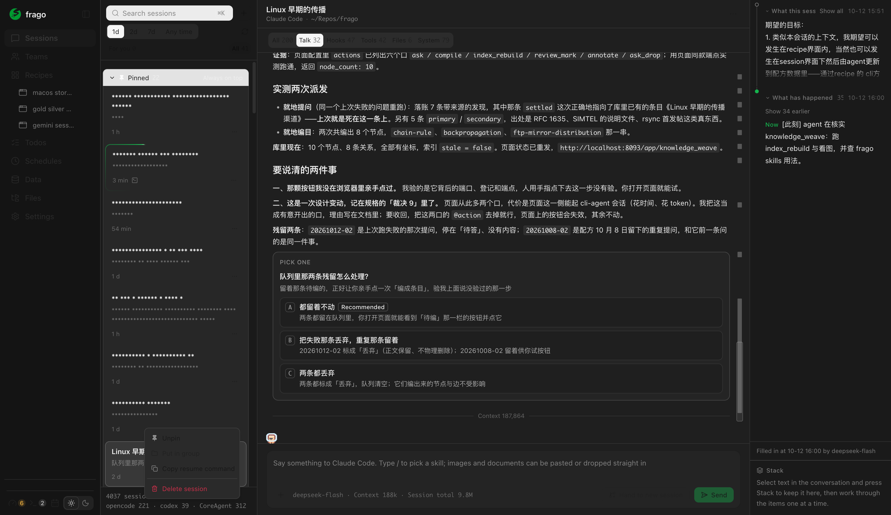
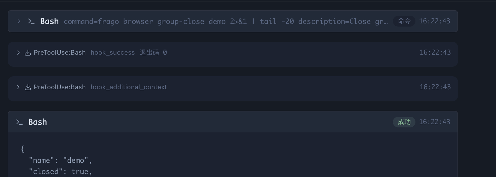
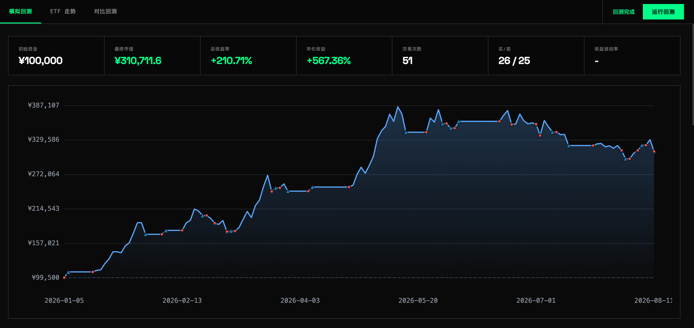
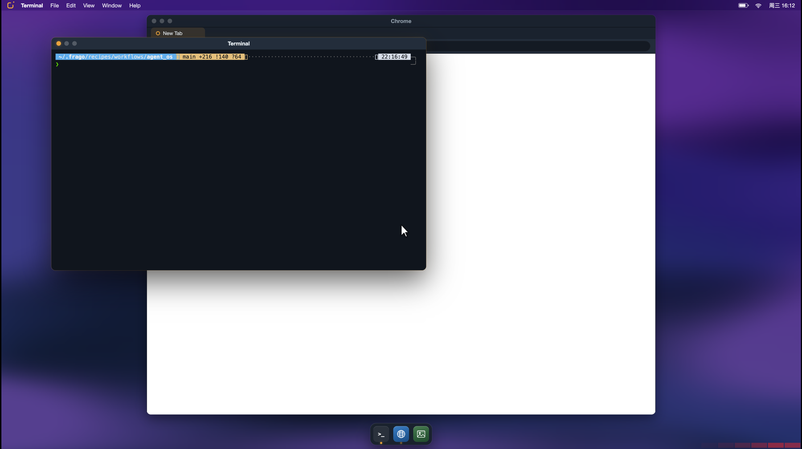
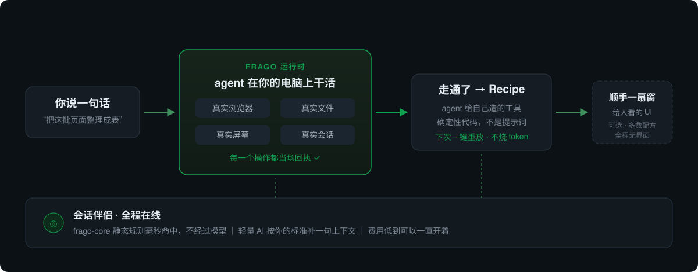

<div align="center">


# frago

**Turn your computer into an operating system for AI agents**

English · [简体中文](README.zh-CN.md) · [**Install**](#install) · [User Guide](docs/user-guide.md) · [Recipes](docs/recipes.md) · [Discussions](https://github.com/tsaijamey/frago/discussions)

[](https://pypi.org/project/frago-cli/)
[](LICENSE)
[](https://github.com/tsaijamey/frago/stargazers)
[](docs/installation.md)



</div>

> frago is not affiliated with OpenClaw. frago predates OpenClaw by approximately one month.

## Why frago

CLI agents offer immense potential for system automation, but in practical engineering they consistently run into three fundamental barriers:

- **Single-session silos**: Capabilities and states are trapped within an interactive conversation. Once the session ends or moves to another window, authentication, context, and execution chains break; they cannot be cleanly orchestrated or scheduled at 3 AM.
- **Dumping entire contexts at startup**: To retain knowledge, standard setups dump hundreds of lines of rule files into the prompt upfront, burning token budgets while diluting attention; switch to a new repo or machine, and the agent reverts to square one.
- **Trial-and-error never hardens into deterministic code**: Hard-won workflows discovered through multi-step reasoning are only saved as prose prompts. Next time, the model must reason through the entire sequence again, consuming tokens repeatedly with unpredictable behavioral drift.

What developers and teams are short of isn't more model choices — it's **a prepared Agent OS**: a host environment that works with any CLI agent as an execution engine, keeping operations disciplined and freezing proven tasks into reusable, automated workflows.

## frago in one line

**frago = an AI agent operating system (Agent OS) that works with any agent.**

frago does not produce proprietary language models, nor does it maintain a closed conversational loop. It treats Claude Code, codex, opencode, agy as execution engines, providing them with real-world control, persistent memory, and reusable workflows.

frago provides the full host runtime above the engine — giving agents real browser and desktop automation, long-term persistent memory, and the workflow infrastructure to freeze working procedures into token-free tools.

## Core Philosophy: From Using AI to Harnessing AI (Harness Engineering)

AI software engineering is evolving across three distinct paradigms:
1. **Prompt Engineering**: Learning how to face an LLM;
2. **Context Engineering**: Learning how to use an LLM;
3. **Harness Engineering**: Learning how to harness an agent.

frago implements this harness across three concrete layers:
- **Hooks determine what the agent knows**: Precise static rules and context companions injected at lifecycle events, with zero persistent model overhead;
- **Recipes determine what the agent doesn't need to repeat**: Procedures proven through reasoning are frozen into deterministic code running without model inference;
- **Skills determine how the agent acts**: Providing standard domain practices and execution playbooks.

## Agent-facing: Core Capabilities

The system-level runtime provided directly to agent engines:

| Core Capability | Definition & Core Responsibility | Commands & Mechanisms |
|---|---|---|
| **1. Guardrails & Rules**<br>Action boundaries | Zero-model static rules injected at critical events, keeping agent behavior strictly aligned without persistent token overhead | `frago hook-rules`<br>`frago book`<br>`~/.frago/hook/*` |
| **2. Computer Use & Automation**<br>Real environment actions | Drive real authenticated browsers and reproducible virtual desktops with full visibility | `frago browser`<br>`frago desktop`<br>`frago apps`<br>`frago view` |
| **3. Long-Term Memory**<br>Targeted recall | Decouples memory into decisions, artifacts, run traces, and handoffs instead of naive context dumps | `frago def` (decisions)<br>`frago context` (artifacts)<br>`frago session search` (traces)<br>`frago todo` (handoff) |
| **4. Recipes**<br>Reusable Workflows | Freeze agent-discovered tasks into standalone, deterministic workflows with zero token overhead on re-runs | `frago recipe`<br>`frago daemon`<br>`frago market` |
| **5. Multi-Agent Coordination & Scheduling**<br>Delegation & background | Delegate subtasks, connect external webhooks, and trigger autonomous background jobs | `frago agent`<br>`frago channel` · `frago reply`<br>`frago remote`<br>`frago schedule` |

## Human-facing: Unified Management Console

A transparent management window that remains cleanly decoupled from agent execution:

| Module / Command | What it gives you |
|---|---|
| **Unified Console**<br>`frago start` · `frago server` | Normalizes session records from heterogeneous agents into a unified Web UI with real-time action timelines |
| **Model Provider Profiles**<br>`frago profile` | Centralizes multi-provider credentials and endpoints, supplied to agents on demand without CLI clutter |
| **Recipe Market**<br>`frago market` | Publish your automated tools, or install community-verified solutions with one click |
| **Environment & Maintenance**<br>`frago init` · `frago update` · `frago autostart` | Desktop client, self-updates, and boot daemons — switch machines without starting from scratch |

## What you can do with it

Those were commands. These are scenarios — all carried by recipes, and the recipes are written by your agent on the spot:

- **You stop needing Office**, because you can simply have the agent build you one to a recipe's spec
- **You stop reshooting a tutorial video for the seventh time** — perform it once on the virtual stage and the recording is the deliverable
- **You stop handing meeting audio to a third party** — transcription, key points and action items all happen on your own machine
- **You stop copy-pasting between five websites** — the agent walks it in one pass, in the browser you're already signed into
- **You stop hand-collating research** — fetch, dedupe, write up and file it in one recipe
- **You stop having to remember how you did it last time** — once it works, it's code you can re-run

### 🖥 The agent lives in a terminal. frago moves it into a web page.

#### Task: "Open this site and read me the title and the first sentence"

<p align="center"></p>

First, what frago does *not* do: the command, the `success`, the timestamp and the return value
are **produced by whichever cli-agent you run**. This machine runs Claude Code and opencode side
by side; the session above happens to be the former. They already emit all of that — it just
scrolls past in their own terminal windows, which makes it hard to manage.

frago doesn't produce receipts, and **it doesn't pick a side**. It reads **every** agent's records,
normalizes them into one shape, and turns them into one web page.

|  | In a terminal | In frago |
|---|---|---|
| **Past sessions** | A resume-style picker that's awkward to use | 1,299 sessions in one list, searchable by title, directory or session id |
| **Switching cli-agent** | Each one keeps its own records, in its own format | Normalized into one shape, merged into one list (above: 1,201 Claude Code + 98 opencode) |
| **Reading a session back** | Page up, screen by screen | Laid out card by card, bucketed as `running / done / stopped / errored` |
| **Continuing the conversation** | Find that terminal window again | Type on the page |
| **Usage** | Count it yourself | A usage calendar |

For people who live in a CLI, this is a convenience.
For people who don't, it's **the line between using an agent and not**.

(Those two `PreToolUse:Bash` rows above are the session companion stepping in — one reporting the receipt, one adding context. More below.)

This next layer is the part frago does itself:

| Layer | What frago does | What you get |
|---|---|---|
| **Logins** | Drives your browser's **own real profile** | Sites you're already signed into just work |
| **Anti-bot** | It *is* a real browser, not a simulation | Checks pass on their own |
| **Concurrency** | Each agent stays in its own real tab group | Two agents work at once without collision; the tab strip shows whose pages are whose |

### 🛠 Once it works, the agent builds itself a tool

#### Task: "I want to re-run this backtest myself and tweak the parameters"

<p align="center"></p>

<p align="center"><sub>A <b>simulated</b> backtest on ¥100,000 of virtual capital, shown to illustrate the interface. Not investment advice.</sub></p>

> **This is just one of them.** That screenshot is one of **317 personal recipes** on a single
> development machine, picked because it photographs well. frago is not a trading tool — other
> recipes on that same machine cut video, draft articles, transcribe meetings, pull arXiv papers,
> scrape public neuroscience datasets, synthesize speech, generate storyboards, keep a ledger of
> past sessions, and pick universities. **What your recipes look like depends on what you keep
> asking an agent to do.**

This is the real difference between frago and "an agent that's good at things": the path that
worked doesn't rot in a chat log. It freezes into a **Recipe** — real, deterministic Python or shell.

|  | The first time | Every time after |
|---|---|---|
| **Who does it** | The agent works it out step by step | A piece of deterministic code |
| **Model involved** | Yes | **No** |
| **Result** | This way today, maybe another way tomorrow | Identical to last time |
| **Tokens** | Burned | **None** |

**A Recipe is a tool the agent builds for itself, not documentation for humans.**

|  | The agent-facing side | The human-facing side |
|---|---|---|
| **Form** | `recipe.md` + deterministic code | A page at `/app/<name>` |
| **How it's used** | `recipe list --format json` to discover · `run` · `schedule` | Open it, tune parameters, read results |
| **Required?** | Yes — this *is* the recipe | **No** — plenty of recipes have no UI at all and are complete software anyway |

Only when a person genuinely needs to look — as with the backtest above, where a human tunes the
parameters and reads the curve — does a recipe hang an interface off the side. The UI is the
optional layer, not the point.

### 🎬 And when you need to show it, there's a stage

#### Task: "Record what you just did as a tutorial video"

<p align="center"></p>

It looks like a macOS desktop; underneath it is all real. That terminal is a real tmux
session, that browser window is a real tab, and the mouse movement and clicks are reproducible.
Perform once, record it, replay it whenever — instead of reshooting your screen a seventh time.

## How it works

<p align="center"></p>

The band across the bottom is the **session companion**, the layer most people underrate.
It comes in two:

| Layer | What it is | Model? | Match speed | Cost |
|---|---|---|---|---|
| **frago-core** | Static rules compiled into a 3 MB native binary | **No** | 34–961 ms measured on this machine, scaling with payload size | **Zero** |
| **Lightweight AI** | Adds one line of context at the right moment, to *your* standards | Yes, but only a short prompt | One call | Negligible |

Its only job is to keep the agent from drifting:

| A common drift | What the companion does |
|---|---|
| Guessing from memory when it should open the browser | Stops it there and points it at the real browser |
| Inventing a new directory for output | Points it at the place that already exists |
| Repeating a mistake you corrected once | Reminds it next time the same situation comes up |

Because the static layer is free and the AI layer only ever runs a short prompt,
**it's cheap enough to leave on permanently**. The settings page shows the live state of both
layers, in plain language.

## Examples: recipes I built for myself

**Illustration only.** These are **not built into frago and don't ship with it**, and they are not a
recommended list — they're private recipes on my own machine, grown around my own life and work.
They're here to answer one question: what can a recipe look like?

frago installs blank. Your recipes grow out of **your** agent doing **your** repetitive work,
and will most likely have nothing to do with any of these.

| Recipe | What the agent does | What a person sees |
|--------|--------------------|--------------------|
| `agent_os` | Reassembles a real tmux session and a real browser tab into a scriptable virtual macOS desktop | The live stage at `/app/agent_os` |
| `etf_backtest_dashboard_v5` | Runs zero-parameter backtests of A-share / cross-border ETF strategies, one set after another | Parameter sliders, net-value curves, per-trade P&L |
| `etf_kdj_ths_auto_trade` | Watches 5-minute KDJ signals and places orders in the Tonghuashun client | Trade receipts and position checks (no LLM in the loop) |
| `gaokao_henan_volunteer_analysis` | Converts score to province rank, matches universities to a family's budget and region, and flags disguised-private or overpriced programs | A report with a verification checklist, plus a web view |
| `meeting_copilot` | Transcribes a live meeting, extracts points, questions and actions from local materials, and can voice-clone a reply onto the mic | A scrolling transcript and question list |
| `article_studio` | One persistent editor agent per article — interviews you, rewrites in your voice, writes back into HTML | Article list on the left, reading and writing panes on the right |

## Install

**There's nothing to download.** frago is installed by the agent you already have. Add the install
skill to Claude Code and ask for it — the skill prepares git and uv, clones the source, builds the
environment, deploys the hooks, walks you through credentials, and finishes by opening a welcome
page where the machine shows you what it can now do. You never type a frago command yourself.

```
/plugin marketplace add tsaijamey/how-to-install-frago
/plugin install how-to-install-frago@how-to-install-frago
```

Then just ask it: **install frago**

→ [**how-to-install-frago**](https://github.com/tsaijamey/how-to-install-frago) — the skill's own repository

Works on macOS, Windows and Linux. Claude Code drives the install; opencode and codex work as agent
cores once it's done. Installing needs only git and uv — a few more things are needed per capability
(tmux to delegate work, Edge for browser automation, ffmpeg to record, bubblewrap to run recipes on
Linux), and the skill asks what you intend to use, sets that up, and says what stays unavailable.

<details>
<summary><b>Rather do it yourself?</b> The package is on PyPI.</summary>

<br>

Requires Python 3.13+. This gets you the CLI and the web UI, but none of the machine preparation
the skill does — hooks, credentials and per-capability dependencies are left to you.

```bash
uv tool install frago-cli   # install
frago init                  # check dependencies, configure a model profile
frago server start          # start the web UI at http://127.0.0.1:8093
```

Don't have uv yet, or want the one-line installer? See [Installation](docs/installation.md).

</details>

> There is no desktop app. The installers attached to older GitHub Releases are no longer maintained.

## Documentation

- [User Guide](docs/user-guide.md) — getting started after install
- [Concepts](docs/concepts.md) — how Recipes, Runs, Sessions and prompting work together
- [Recipe System](docs/recipes.md) — the recipe command surface, end to end
- [Examples](docs/examples.md) — practical Run + Recipe + browser workflows
- [Agent Cores](docs/agent-cores.md) — Claude Code / codex / opencode compared: equivalent, unique, and how usage differs
- [Browser Support](docs/browser-support.md) — backends, ports, tab groups, the desktop stage
- [Developer Docs](docs/developer.md) — CLI, architecture, development setup

Inside the product, `frago book` reads the shipped knowledge base — the canonical operational manual that stays in sync with the code.

## License

MIT — see [LICENSE](LICENSE)

## Contributing

- [Submit an Issue](https://github.com/tsaijamey/frago/issues)
- [Discussions](https://github.com/tsaijamey/frago/discussions)
- [Community recipes](https://github.com/tsaijamey/frago-recipe-community) — public recipes live in their own repository

---

<div align="center"><sub>Created with Claude Code</sub></div>
