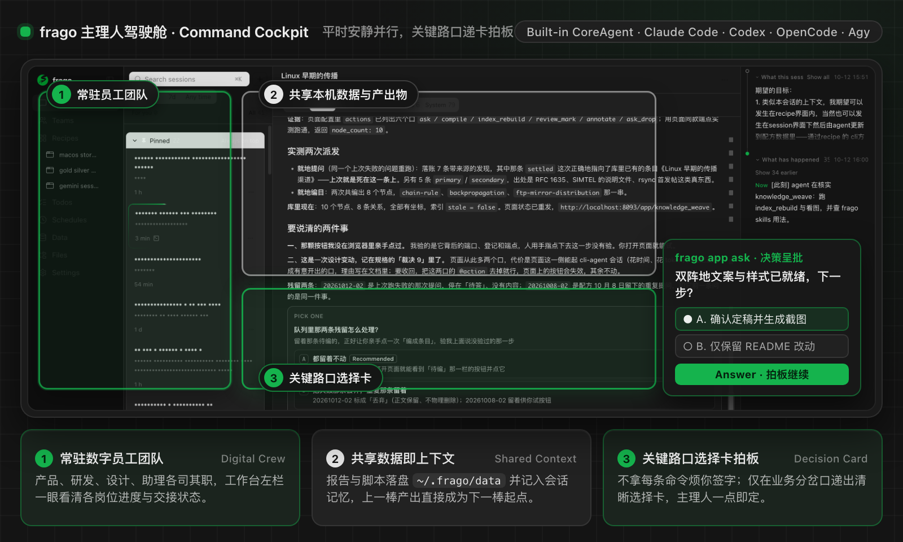
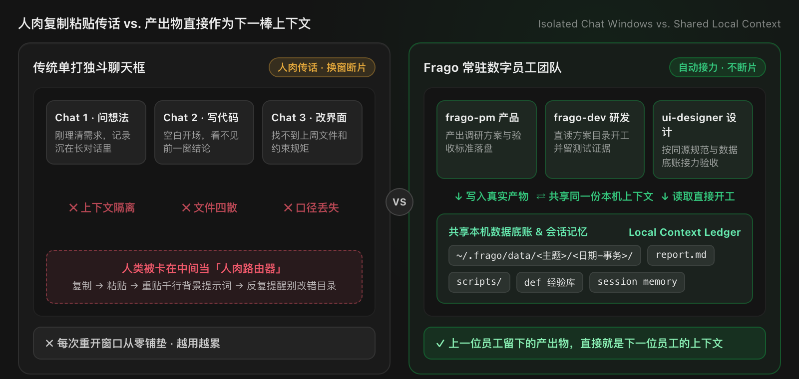
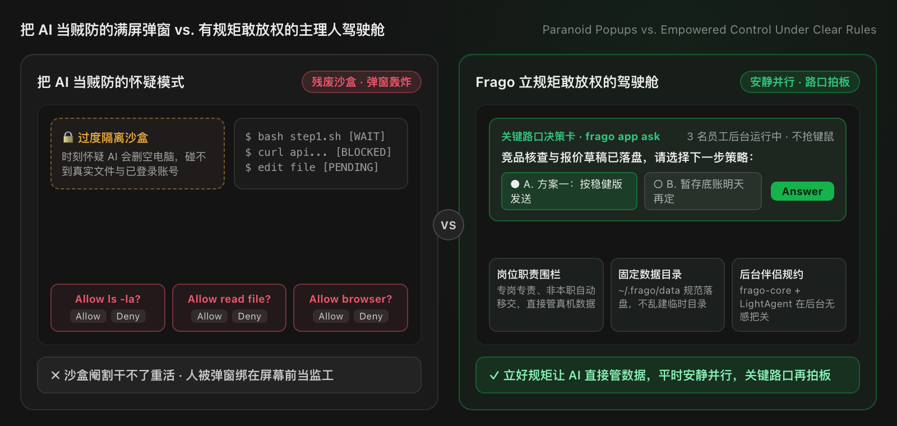

<div align="center">


# frago

**不只是聊天框，而是常驻你电脑的数字员工团队。**

产品、研发、设计、助理各司其职。因为有清晰的岗位规矩，frago 允许数字员工**直接管理你的本机数据与会话记录**，让上一棒的产出物直接成为下一棒的上下文；平时在后台安静干活，关键路口递张选择卡请你拍板。

**已在数十位热心用户的电脑上真实运行数万次会话 · 支持 macOS / Windows / Linux**

简体中文 · [English](README.md) · [**30 秒安装**](#30-秒上手) · [官网 frago.ai](https://www.frago.ai) · [使用指南](docs/user-guide.zh-CN.md) · [讨论区](https://github.com/tsaijamey/frago/discussions)



</div>

---

## 为什么聊天框再聪明，复杂正事还是得你自己扛？

1. **办大事靠团队分工，不靠守着一个聊天框**
   一个对话框干不了长线工作。在 frago 里，产品、研发、设计、投研、日常助理各司其职，自带岗位边界与工作台账，干完一棒自动交接下一棒。
2. **员工要能互相配合，就必须共享完整的上下文**
   如果每次交接都要你在几个窗口间复制粘贴传话，那不是团队。在 frago 里，上一位员工留下的本机文件、报告、脚本与历史会话，直接就是下一位员工开工的上下文，换人接手不断片。
3. **立好规矩，才敢让 AI 直接管理你的本机数据**
   多数工具时时刻刻怀疑 AI 会删掉你电脑上的所有东西，只能用残废沙盒和满屏弹窗捆死它的手脚。frago 用清晰的岗位边界、固定数据目录（`~/.frago/data`）与后台伴侣规约建立秩序，让你放心把本机数据交给数字员工直接打理。

---

## 一眼看懂：单个聊天框 vs. 常驻数字员工团队

### 1. 人肉复制粘贴传话 vs. 产出物直接作为下一棒上下文

<p align="center"></p>

### 2. 把 AI 当贼防的满屏弹窗 vs. 有规矩敢放权的主理人驾驶舱

<p align="center"></p>

---

## 支撑这支团队运转的四项设计（点开看细节）

<details>
<summary><b>1. 常驻岗位员工与可换大脑：不绑死任何一家模型</b></summary>
<br>
每位数字员工都有明确的岗位职责、数据底账与非本职自动移交规矩。frago 自带开箱即用的内置执行内核（<b>CoreAgent</b>），同时支持把不同岗位绑定到你已有的 <b>Claude Code</b>、<b>Codex</b>、<b>OpenCode</b> 或 <b>Antigravity (agy)</b> 上。换底层模型，不丢团队规矩与本地数据。
</details>

<details>
<summary><b>2. 直接管理本机数据：四层上下文资产与伴侣规约</b></summary>
<br>
<ul>
<li><b>产出物底账</b>（<code>~/.frago/data/&lt;主题&gt;/&lt;日期-事务&gt;/</code>）：每场任务的报告、脚本与账本落盘在固定目录，下一位员工直接读取接手；</li>
<li><b>领域经验库</b>（<code>frago def</code>）：踩过的坑与业务口径随手入库，遇到同类任务自动唤醒；</li>
<li><b>历史会话检索</b>（<code>frago session search / ask</code>）：跨数万场历史会话精准检索并追问前情；</li>
<li><b>后台伴侣规约</b>（<code>frago-core</code> + <code>LightAgent</code>）：自动核验目录规范、守护职责围栏并检查交差质量，让你放心把本机数据交给团队管理。</li>
</ul>
</details>

<details>
<summary><b>3. 同机办公不抢鼠标：已登录真机浏览器 + 后台虚拟桌面</b></summary>
<br>
<ul>
<li><b>真机浏览器协同</b>（<code>frago browser</code>）：直接复用你已登录的浏览器环境办事，免去反复扫码；每位数字员工待在独立的颜色标签组里，不切走你正在看的网页。</li>
<li><b>后台虚拟桌面工位</b>（<code>frago desktop</code>）：长耗时点击与录屏在独立的后台虚拟屏幕里安静完成，你在前台照常打字；遇验证时一键接管，过检自动续跑。</li>
</ul>
</details>

<details>
<summary><b>4. 关键路口递选择卡 + 跑顺的手艺冻成「零 Token 配方」</b></summary>
<br>
<ul>
<li><b>业务路口选择卡</b>（<code>frago app ask</code>）：不拿每条命令烦你签字；只在方案就绪、遇到方向取舍时递出结构化选择卡，点一下即拍板。</li>
<li><b>零 Token 配方固化</b>（<code>frago recipe</code>）：员工摸索跑通一次的流程（如日常情报巡检、跨站资料整理、本地音视频处理、业务看板），当场冻结成确定性代码——此后每次调用 <b>0 Token 消耗、结果分毫不差</b>。</li>
</ul>
</details>

---

## 30 秒上手

**不需要手动配环境，也不要求你先懂命令行。**
一行命令会自动配齐全部依赖（含内置 CoreAgent），并在浏览器打开主理人驾驶舱 `http://127.0.0.1:8093`。

### 方式一：一行命令全自动安装（推荐）

**macOS / Linux（打开「终端」粘贴回车）：**
```bash
curl -fsSL https://frago.ai/install.sh | bash
```

**Windows（打开「PowerShell」粘贴回车）：**
```powershell
irm https://frago.ai/install.ps1 | iex
```

### 方式二：让你已有的 Claude Code / Codex 替你装

```text
/plugin marketplace add tsaijamey/how-to-install-frago
/plugin install how-to-install-frago@how-to-install-frago
```
然后直接对它说：**帮我安装 frago**（详见 [how-to-install-frago](https://github.com/tsaijamey/how-to-install-frago)）。

<details>
<summary><b>手动安装 / 开发者方式（PyPI 与源码）</b></summary>
<br>
要求 Python 3.13+：
```bash
uv tool install frago-cli   # 安装 CLI 与主理人驾驶舱
frago init                  # 检测依赖并初始化配置
frago server start          # 启动服务（http://127.0.0.1:8093）
```
完整多平台依赖说明见 [安装指南](docs/installation.zh-CN.md)。
</details>

---

## 文档与社区

| 你想了解什么 | 推荐入口 |
|---|---|
| 10 分钟内让数字员工办成第一件事 | [使用指南](docs/user-guide.zh-CN.md) |
| 数字员工团队、本机数据上下文与零 Token 配方 | [关键概念](docs/concepts.zh-CN.md) · [配方系统](docs/recipes.zh-CN.md) |
| 多家代理内核搭配与真机浏览器协同 | [内核对比](docs/agent-cores.zh-CN.md) · [浏览器支持](docs/browser-support.zh-CN.md) |
| 现成配方库与问题反馈 | [社区配方仓库](https://github.com/tsaijamey/frago-recipe-community) · [讨论区](https://github.com/tsaijamey/frago/discussions) · [Issues](https://github.com/tsaijamey/frago/issues) |

---

<div align="center">
<sub>MIT License · 你的数字员工与本机数据永远属于你自己 · Created with frago<br/>注：frago 为独立开源项目，与 OpenClaw 及其关联方无任何关联。</sub>
</div>
