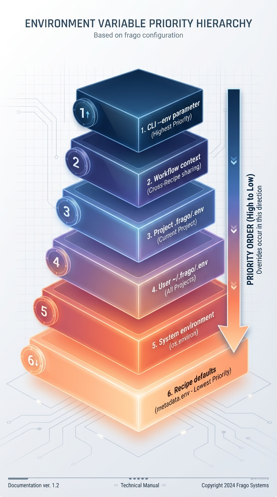

# Recipe 系统指南（AI-First）

## 概述

本指南展示 **Claude Code AI Agent** 如何使用新的 Recipe 系统。设计理念：AI 是主要使用者，人类可以手动执行（次要场景）。

**AI 核心能力**:
1. 通过元数据发现和选择合适的 Recipe
2. 根据任务需求选择输出去向（stdout/file/clipboard）
3. 通过 `frago recipe plan` / `frago recipe create` 生成编排 Workflow Recipe
4. 读懂失败提示与执行记录，据此采取应对策略

---

## AI 使用场景快速开始

### 场景 1: AI 发现并执行 Recipe

**用户意图**: "帮我提取这个 YouTube 视频的字幕并保存为文件"

**AI 执行流程**:

#### Step 1: 查询可用 Recipe（JSON 格式）

```bash
# AI 调用 Bash 工具
frago recipe list --format json
```

**AI 接收到的 JSON 响应**:
```json
[
  {
    "name": "youtube_extract_video_transcript",
    "type": "atomic",
    "runtime": "chrome-js",
    "description": "从 YouTube 视频页面提取完整字幕内容",
    "use_cases": [
      "获取字幕用于翻译",
      "制作字幕文件",
      "分析视频内容"
    ],
    "tags": ["web-scraping", "youtube", "transcript"],
    "output_targets": ["stdout", "file"],
    "version": "1.2.0",
    "source": "Community"
  },
  {
    "name": "arxiv_search_papers",
    "type": "atomic",
    "runtime": "python",
    "description": "在 arXiv 学术数据库中搜索论文",
    "use_cases": [
      "查找最新的计算机科学论文",
      "构建文献综述的数据源"
    ],
    "tags": ["academic-search", "arxiv"],
    "output_targets": ["stdout", "file"],
    "version": "1.0.0",
    "source": "Community"
  }
]
```

#### Step 2: AI 分析并选择 Recipe

AI 思考过程:
1. 用户需要提取 YouTube 字幕 → 匹配 `youtube_extract_video_transcript`
2. 检查 `use_cases`: 包含 "获取字幕用于翻译" ✓
3. 检查 `output_targets`: 支持 `file` ✓
4. 决策：使用该 Recipe，输出到文件

#### Step 3: AI 执行 Recipe

```bash
# AI 调用 Bash 工具
frago recipe run youtube_extract_video_transcript \
  --params '{"url": "https://www.youtube.com/watch?v=dQw4w9WgXcQ"}' \
  --output-file transcript.json
```

**执行成功**: 落进文件的是配方自己的结果，只有 `data`，没有 `success` 之类的包裹：

```json
{
  "title": "Rick Astley - Never Gonna Give You Up",
  "transcript": "We're no strangers to love...",
  "language": "en",
  "duration": 213
}
```

**同时文件已保存**: `transcript.json`

stderr 上另有一行执行摘要和一个保存提示，不影响解析：

```text
[recipe] youtube_extract_video_transcript | <execution_id> | OK | 3.2s
[OK] Result saved to: transcript.json
```

真实去向：配方数据走 stdout（或 `--output-file` / `--output-clipboard`），
stderr 只放执行日志和摘要行，两边不混；不带 `--output-file` 时 stdout 拿到的同样只是 `data`。

---

### 场景 2: AI 处理错误并重试

**执行失败**: stdout 为空，退出码非零，stderr 上是这一行：

```text
Error: Recipe 'youtube_extract_video_transcript' execution failed (exit code: 1): Error: Element not found: .transcript-button
```

失败时 CLI 不产出结构化错误对象。配方自己写到 stderr 的内容会作为「原因」拼在这一行末尾。

**AI 分析错误**:
1. 退出码非零 + `Error:` 行 → 执行失败
2. 行尾原因 "Element not found: .transcript-button" → 页面结构变化或无字幕
3. **AI 策略**: 向用户报告 "该视频可能没有字幕或 YouTube 页面结构已更新"

需要事后核对细节时用 `frago recipe executions --status failed --format json`，
那里有每次执行的记录（含 stdout/stderr、退出码、耗时），比解析 CLI 提示可靠。

---

### 场景 3: AI 自动生成 Workflow Recipe

**用户意图**: "在 arXiv 上批量搜索 10 个研究主题，并把结果保存为 JSON 文件"

**AI 执行流程**:

#### Step 1: AI 用 `frago recipe plan` 起草规格

```bash
# 两条都必须后台跑（Bash 工具的 run_in_background: true）：
# 每一条都会拉起一个 worker 写十几到几十分钟，前台 10 分钟就被砍
frago recipe plan arxiv_batch_search \
  --prompt "在 arXiv 批量搜索 10 个主题并保存为 JSON" \
  --type workflow --runtime python
```

规格文件写完后，再用 `frago recipe create arxiv_batch_search` 按规格生成模板。

#### Step 2: AI 自动生成 Workflow 脚本

AI 生成的文件: `~/.frago/recipes/workflows/arxiv_batch_search/recipe.py`

```python
#!/usr/bin/env python3
"""
Workflow: 批量搜索 arXiv
由 Claude Code 自动生成
"""
import sys, json, subprocess

def run_recipe(name, params):
    """配方跑在隔离视图里，导入不了 frago，调子配方只能走命令行"""
    proc = subprocess.run(
        ['frago', 'recipe', 'run', name, '--params', json.dumps(params, ensure_ascii=False)],
        capture_output=True, text=True,
    )
    if proc.returncode != 0:
        raise RuntimeError(proc.stderr.strip() or f"{name} failed")
    return json.loads(proc.stdout)   # stdout 只有子配方的 data

def main():
    params = json.loads(sys.argv[1] if len(sys.argv) > 1 else '{}')
    queries = params.get('queries', [])

    if not queries:
        print(json.dumps({"error": "Missing 'queries' parameter"}), file=sys.stderr)
        sys.exit(1)

    results = []

    for i, query in enumerate(queries[:10], 1):
        try:
            print(f"正在搜索第 {i}/10 个主题...", file=sys.stderr)
            results.append({"query": query, "papers": run_recipe('arxiv_search_papers', {'query': query})})
        except Exception as e:
            results.append({"query": query, "error": str(e)})

    print(json.dumps({"results": results}, ensure_ascii=False))

if __name__ == '__main__':
    main()
```

#### Step 3: AI 生成元数据文件

`~/.frago/recipes/workflows/arxiv_batch_search/recipe.md`:

```yaml
---
name: arxiv_batch_search
type: workflow
runtime: python
description: "在 arXiv 上按多个主题批量搜索并把结果保存为 JSON"
use_cases:
  - "批量文献检索"
  - "跨主题构建阅读清单"
tags:
  - arxiv
  - batch-processing
output_targets:
  - stdout
  - file
dependencies:
  - arxiv_search_papers
uses_frago_cli: true    # 脚本要 shell 调 frago recipe run，不写就拿不到 frago 的工作目录
flow:                   # workflow 必填；step 编号不重复，recipe 引用要在 dependencies 里
  - step: 1
    action: "validate_input"
    description: "检查 queries 非空且不超过 10 条"
    inputs:
      - source: "params.queries"
  - step: 2
    action: "search_each_topic"
    description: "逐条调用 arxiv_search_papers 取论文列表"
    recipe: "arxiv_search_papers"
    inputs:
      - source: "params.queries"
    outputs:
      - name: "papers"
        type: "list"
version: 1.0.0
---
```

#### Step 4: AI 执行 Workflow

```bash
frago recipe run arxiv_batch_search \
  --params '{"queries": ["multi-agent systems", "diffusion models", "..."]}' \
  --output-file papers.json
```

---

## 人类手动使用（次要场景）

下面演示配方目录里到底有什么。**正式做法不手搓文件**：先 `frago recipe plan` 定规格、
`frago recipe create` 生成模板，再在模板上填，最后 `frago recipe validate` 过一遍。

### 场景：创建一个简单的剪贴板读取 Recipe

#### 1. 创建脚本文件

```bash
# 创建 Python 脚本
mkdir -p ~/.frago/recipes/atomic/system/clipboard_read
cat > ~/.frago/recipes/atomic/system/clipboard_read/recipe.py <<'EOF'
#!/usr/bin/env python3
import sys
import json
import subprocess

# 从命令行参数读取输入
params = json.loads(sys.argv[1] if len(sys.argv) > 1 else '{}')

# 读取剪贴板内容（使用 xclip）
result = subprocess.run(['xclip', '-selection', 'clipboard', '-o'],
                        capture_output=True, text=True, check=True)

# 输出 JSON 结果到 stdout
output = {
    "content": result.stdout,
    "length": len(result.stdout)
}
print(json.dumps(output, ensure_ascii=False))
EOF

# 添加执行权限（Python 脚本不强制，但推荐）
chmod +x ~/.frago/recipes/atomic/system/clipboard_read/recipe.py
```

#### 2. 创建元数据文件

```bash
cat > ~/.frago/recipes/atomic/system/clipboard_read/recipe.md <<'EOF'
---
name: clipboard_read
type: atomic
runtime: python
description: "读取系统剪贴板内容"
use_cases:
  - "把刚复制的内容接进自动化流程"
output_targets:
  - stdout
inputs: {}
outputs:
  content: string
  length: number
version: 1.0.0
dependencies: []
uses_commands: [xclip]    # 脚本要起外部命令；不写就拿不到它的配置与登录态
---

# 剪贴板读取 Recipe

## 功能描述

读取 Linux 系统剪贴板的当前内容（使用 xclip 工具）。

## 前置条件

- 安装 xclip: `sudo apt install xclip`
- 运行在 X11 环境（Wayland 需调整）

## 使用方法

```bash
frago recipe run clipboard_read
```

## 预期输出

```json
{
  "content": "复制的文本内容",
  "length": 10
}
```

## 注意事项

- 如剪贴板为空，`content` 为空字符串
- 仅支持文本内容，不支持图片等二进制数据
EOF
```

#### 3. 验证并执行

```bash
# 查看 Recipe 信息
frago recipe info clipboard_read

# 执行 Recipe
frago recipe run clipboard_read
```

---

## 创建编排 Recipe (Workflow)

### 场景：批量提取多个 YouTube 视频字幕

#### 1. 创建 Workflow 脚本

```bash
mkdir -p ~/.frago/recipes/workflows/youtube_batch_extract
cat > ~/.frago/recipes/workflows/youtube_batch_extract/recipe.py <<'EOF'
#!/usr/bin/env python3
import sys
import json
import subprocess

def run_recipe(name, params):
    # 配方跑在隔离视图里，导入不了 frago，调子配方只能走命令行
    proc = subprocess.run(
        ['frago', 'recipe', 'run', name, '--params', json.dumps(params, ensure_ascii=False)],
        capture_output=True, text=True,
    )
    if proc.returncode != 0:
        raise RuntimeError(proc.stderr.strip() or f"{name} failed")
    return json.loads(proc.stdout)   # stdout 只有子配方的 data

def main():
    # 从命令行参数读取输入
    params = json.loads(sys.argv[1] if len(sys.argv) > 1 else '{}')
    video_urls = params.get('urls', [])

    if not video_urls:
        print(json.dumps({"error": "Missing 'urls' parameter"}), file=sys.stderr)
        sys.exit(1)

    results = []
    for url in video_urls:
        try:
            results.append(run_recipe('youtube_extract_video_transcript', {'url': url}))
        except Exception as e:
            results.append({
                "url": url,
                "error": str(e)
            })

    # 输出 JSON 结果
    output = {
        "videos": results,
        "total": len(video_urls),
        "success_count": sum(1 for r in results if 'error' not in r)
    }
    print(json.dumps(output, ensure_ascii=False))

if __name__ == '__main__':
    main()
EOF

chmod +x ~/.frago/recipes/workflows/youtube_batch_extract/recipe.py
```

#### 2. 创建元数据文件

```bash
cat > ~/.frago/recipes/workflows/youtube_batch_extract/recipe.md <<'EOF'
---
name: youtube_batch_extract
type: workflow
runtime: python
description: "批量提取多个 YouTube 视频字幕"
use_cases:
  - "把一串视频链接的字幕一次抓完"
  - "给翻译流水线准备素材"
output_targets:
  - stdout
inputs:
  urls:
    type: array
    required: true
    description: "YouTube 视频 URL 列表"
outputs:
  videos: array
  total: number
  success_count: number
version: 1.0.0
dependencies:
  - youtube_extract_video_transcript
uses_frago_cli: true    # 脚本要 shell 调 frago recipe run
flow:                   # workflow 必填
  - step: 1
    action: "validate_input"
    description: "检查 urls 非空"
    inputs:
      - source: "params.urls"
  - step: 2
    action: "extract_each_video"
    description: "逐个调用 youtube_extract_video_transcript 取字幕"
    recipe: "youtube_extract_video_transcript"
    inputs:
      - source: "params.urls"
    outputs:
      - name: "videos"
        type: "list"
---

# YouTube 批量提取 Workflow

## 功能描述

批量调用 `youtube_extract_video_transcript` Recipe，提取多个 YouTube 视频的字幕。

## 使用方法

```bash
frago recipe run youtube_batch_extract \
  --params '{"urls": ["https://youtube.com/watch?v=...", "..."]}'
```

## 预期输出

```json
{
  "videos": [
    {"title": "...", "transcript": "..."},
    {"title": "...", "transcript": "..."}
  ],
  "total": 2,
  "success_count": 2
}
```
EOF
```

#### 3. 执行 Workflow

```bash
frago recipe run youtube_batch_extract \
  --params '{
    "urls": [
      "https://www.youtube.com/watch?v=dQw4w9WgXcQ",
      "https://www.youtube.com/watch?v=oHg5SJYRHA0"
    ]
  }'
```

---

## 常见任务

### 查看 Recipe 详细信息

```bash
frago recipe info <recipe_name>
```

### 使用参数文件

```bash
# 创建参数文件
cat > params.json <<EOF
{
  "url": "https://www.youtube.com/watch?v=dQw4w9WgXcQ"
}
EOF

# 使用参数文件
frago recipe run youtube_extract_video_transcript \
  --params-file params.json
```

### 将结果保存到文件

```bash
frago recipe run youtube_extract_video_transcript \
  --params '{"url": "..."}' \
  --output-file result.json
```

### 调试 Recipe 执行

```bash
# 启用调试模式
frago --debug recipe run <recipe_name> --params '{...}'
```

`--debug` 打开的是执行链路的技术日志（配方扫描、隔离后端、退出码），
输出到 stderr，与结构化结果（stdout 上的 JSON）分开。日志的具体行不构成契约，
排查问题时按「哪一步报错、报的什么」读，别写脚本去解析它。

```text
{ "…配方自己的结果…" }
```

---

## Recipe 命令参考

完整的命令面（细节用 `frago recipe <command> --help`）：

| 命令 | 用途 |
|------|------|
| `plan` | 由 agent 起草配方规格 `spec.md`（`--prompt`、`--type`、`--runtime`，须后台跑） |
| `create` | 由 agent 按规格或 prompt 生成配方（须后台跑） |
| `list` | 列出配方（`--source user\|community\|all`、`--type atomic\|workflow\|all`、`--format table\|json\|names`） |
| `info` | 查看元数据、输入参数、依赖与 `secrets` 定义（`--format text\|json\|yaml`） |
| `run` | 执行（`--source`、`--params`、`--params-file`、`-e/--env`、`--output-file`、`--output-clipboard`、`--timeout`、`--async`） |
| `schedule` | 定时执行（`--interval 30s/10m/2h`、`--max-runs`、`--start-at/--stop-at`、`--params`、`-e/--env`、`--timeout`） |
| `executions` / `execution` | 列出 / 查看历史执行 |
| `cancel` | 取消正在运行的执行 |
| `publish` | 发布配方页面要展示的状态，并打印页面地址 |
| `open` | 按配方名或页面地址打开配方页面（`--slot`） |
| `expose` / `unexpose` / `exposed` | 决定谁能打开配方页面 / 收回对外开放 / 列出当前对外开放的页面 |
| `validate` | 校验配方目录的字段完整性与正确性 |
| `install` / `update` / `uninstall` | 管理社区配方 |
| `search` | 按关键字搜索社区配方仓库 |
| `share` | 分享配方到社区仓库 |
| `folder` | 在本机给配方分文件夹（顺序即网格上的顺序） |
| `reads` | 查哪些配方读了别的配方的哪块数据、实际拿到什么 |
| `data-migrate` | 把配方数据迁到新布局（只复制不删除，记迁移清单） |

### 配方存放位置

```
~/.frago/recipes/                  # 用户级（最高优先级）
├── atomic/system/<name>/          # Python / shell
├── atomic/chrome/<name>/          # Chrome-js
└── workflows/<name>/              # 工作流
~/.frago/community-recipes/        # 已安装的社区配方
```

每个配方是一个目录：`recipe.md`（YAML frontmatter 元数据）+ 执行脚本；
`spec.md` 设计文档可选。社区配方通过
`frago recipe install community:<name>` 装进 `~/.frago/community-recipes/`，
来源是 [frago-recipe-community](https://github.com/tsaijamey/frago-recipe-community)。

frago 包本身不带任何配方。你能跑的每一个配方，要么是自己写的，要么是装来的——
不存在第三层「装完就有、换台机器却没有」的隐形配方。

### 沙箱隔离

配方不直接跑在你的系统里，跑在一个只看得见指定目录的视图中：

- 可写：本次运行的落点、`~/.frago/recipe-data/<配方名>/`；别人写了 `shares` 交出来的那块只读
- 只读：系统与解释器、配方自身源码
- 其余一切不存在，越界当场失败

视图只管文件，麦克风、摄像头、系统服务这些仍由操作系统的授权决定。后端由内核来管：
macOS 用自带的 `sandbox-exec`；Linux 用 `bwrap`，没装 bubblewrap 就拒绝起配方
（`apt install bubblewrap`）。

配方要起外部命令（`gh`、`ffmpeg`、`yt-dlp`……）必须在 `recipe.md` 写 `uses_commands: [命令名]`；
要 shell 调 frago 自己的命令写 `uses_frago_cli: true`。不写的话命令多半启动得了，但读不到它放在
家目录里的配置和登录态。写了之后每台机器**第一次运行**时由 CoreAgent 实地查看安装位置、判断
只读交出去是否安全，结论登记在 `~/.frago/recipe-data/<配方名>/grants.json`，之后照登记开放；
配方代码改了会重审。服务端常驻启动不做审计，新机器上先手动 `frago recipe run` 一次。

要关掉隔离，必须在 `~/.frago/config.json` 明写 `"recipe": {"isolation": "off"}`。

## 最佳实践

### 1. Recipe 命名规范

- 使用小写字母、数字、下划线、连字符
- 原子 Recipe: `<platform>_<action>`（如 `youtube_extract_transcript`）
- Workflow Recipe: `<platform>_batch_<action>` 或 `<workflow_name>`

### 2. 参数验证

在 Recipe 脚本中验证必需参数。自己处理掉的失败按约定往 stdout 打一个带 `error` 的 JSON，
退出码非零，执行器会把 `error` 里的那句话当成失败原因呈现出来：

```python
import sys, json

params = json.loads(sys.argv[1] if len(sys.argv) > 1 else '{}')

# 验证必需参数
if 'url' not in params:
    print(json.dumps({"success": False, "error": "Missing required parameter: url"}))
    sys.exit(1)
```

### 3. 错误处理

成功时 stdout 只放配方自己的数据，不要再套一层 `success`/`data`：

```python
try:
    result = do_something()
    print(json.dumps(result, ensure_ascii=False))
except Exception as e:
    # error 写成人能读的一句话，它会出现在 CLI 的失败提示里
    print(json.dumps({"success": False, "error": str(e)}, ensure_ascii=False))
    sys.exit(1)
```

过程日志一律走 stderr（`print(..., file=sys.stderr)`），否则会把结果 JSON 弄脏。

### 4. 版本管理

在元数据中使用语义化版本号：

```yaml
version: "1.0.0"  # 主版本.次版本.修订号
```

- 主版本：不兼容的 API 变更
- 次版本：新增功能（向后兼容）
- 修订号：Bug 修复

### 5. 依赖声明

在 Workflow 元数据中声明依赖：

```yaml
dependencies:
  - youtube_extract_video_transcript
  - clipboard_read
```

`frago recipe validate` 会检查 workflow 声明的依赖是否已在这台机器上注册；`run` 之前不会替你补装。

---

## 环境变量支持

Recipe 系统支持环境变量，用于管理 API 密钥、运行时配置等敏感或可变信息。

### 设计原则

- **完整继承系统环境**：Recipe 执行时继承所有系统环境变量（PATH、HOME 等）
- **多级配置优先级**：CLI `--env` > Workflow 共享变量 > 项目级 `.env` > 用户级 `.env` > 系统环境
- **凭据单独走一条通道**：密钥、令牌声明在 `secrets` 里，运行时经 `FRAGO_SECRETS` 注入，不散落在环境变量里
- **Workflow 上下文共享**：多个 Recipe 间可共享环境变量

### 在 Recipe 中声明环境变量

非凭据类配置（模型名、上限之类的可变量）写在元数据的 `env` 字段：

```yaml
---
name: openai_chat
type: atomic
runtime: python
description: "调用 OpenAI API 进行对话"
use_cases:
  - "AI 对话生成"
  - "文本处理"
output_targets:
  - stdout
env:
  MODEL_NAME:
    default: "gpt-4o"
    description: "使用的模型名称"
  MAX_TOKENS:
    default: "1000"
    description: "最大 token 数"
version: "1.0.0"
---
```

`env` 目前只是声明：执行时环境变量的实际来源是 `.env` 文件、系统环境和 `-e` 覆盖，
字段里的 `required` / `default` 不再由执行器校验。

**凭据必须声明在 `secrets` 里**，不能写进 `env`：

```yaml
secrets:
  OPENAI_API_KEY:
    type: string
    required: true
    description: "OpenAI API 密钥"
```

执行器按 schema 从 `~/.frago/recipes.local.json` 过滤出声明的字段，序列化成
`FRAGO_SECRETS` 注入进程；`required: true` 的字段缺失时直接拒绝执行。
脚本里硬读 `*_API_KEY` / `*_TOKEN` / `*_SECRET` / `*_PASSWORD` / `*_ACCESS_KEY`
（`os.environ[...]` 或 `$VAR`），会被 `frago recipe validate` 判成 error；
声明了 `secrets` 却没读 `FRAGO_SECRETS` 同样是 error。

**字段说明**：

| 字段 | 类型 | 说明 |
|------|------|------|
| `type` | string | `secrets` 必填，取 string / number / boolean / object / array |
| `required` | boolean | `secrets` 中为是否必需（缺失时拒绝执行） |
| `default` | string | `env` 中的默认值（仅声明用，执行器不代填） |
| `description` | string | 给人看的说明 |

### 配置环境变量

#### 方式一：配置文件（推荐）

创建 `.env` 文件存储环境变量：

**用户级配置**（适用于所有项目）：
```bash
# ~/.frago/.env
DEFAULT_MODEL=gpt-4o
MAX_TOKENS=1000
```

**项目级配置**（仅当前项目）：
```bash
# .frago/.env
MODEL_NAME=gpt-4o-mini
MAX_TOKENS=2000
DEBUG=true
```

凭据不放 `.env`，放 `~/.frago/recipes.local.json`，按配方名归拢：

```json
{
  "openai_chat": {
    "OPENAI_API_KEY": "sk-your-api-key"
  }
}
```

WebUI 的配方设置页读写的就是这个文件；手工改也行，key 要与 `recipe.md` 里
`secrets` 声明的字段同名。

#### 方式二：CLI 参数覆盖

使用 `--env` 或 `-e` 参数在执行时覆盖非凭据的环境变量：

```bash
# 单个环境变量
frago recipe run openai_chat \
  --params '{"prompt": "Hello"}' \
  -e MODEL_NAME=gpt-4

# 多个环境变量
frago recipe run openai_chat \
  --params '{"prompt": "Hello"}' \
  -e MODEL_NAME=gpt-4 \
  -e MAX_TOKENS=500
```

#### 方式三：系统环境变量

直接在 shell 中导出：

```bash
export MODEL_NAME=gpt-4o
frago recipe run openai_chat --params '{"prompt": "Hello"}'
```

### 优先级规则

环境变量按以下优先级解析（高到低）：



实际解析顺序：`-e/--env` 覆盖 > Workflow 共享变量 > 项目级 `.env` > 用户级 `.env` > 系统环境。
`FRAGO_SECRETS` 单独注入，不参与这个合并。

### 在脚本中使用环境变量

**Python Recipe**：
```python
#!/usr/bin/env python3
import os
import sys
import json

# 非凭据配置：环境变量已注入，直接读 os.environ
model = os.environ.get('MODEL_NAME', 'gpt-4o')

# 凭据：只从 FRAGO_SECRETS 读，别直接读 os.environ['OPENAI_API_KEY']
secrets = json.loads(os.environ.get('FRAGO_SECRETS', '{}'))
api_key = secrets.get('OPENAI_API_KEY')

if not api_key:
    print(json.dumps({"error": "OPENAI_API_KEY not set"}), file=sys.stderr)
    sys.exit(1)

# 使用环境变量...
result = {"model": model, "status": "ready"}
print(json.dumps(result))
```

**Shell Recipe**：
```bash
#!/bin/bash
# 环境变量已自动注入，直接使用
echo "Using model: $MODEL_NAME"
echo "API Key present: $(printf '%s' "$FRAGO_SECRETS" | grep -q OPENAI_API_KEY && echo 'yes' || echo 'no')"

# 输出 JSON
cat <<EOF
{
  "model": "$MODEL_NAME",
  "configured": true
}
EOF
```

### Workflow 上下文共享

在 Workflow 中，多个 Recipe 可共享环境变量。配方之间靠 `-e` 逐层传下去：

```python
#!/usr/bin/env python3
"""Workflow: 批量处理任务"""
import sys
import json
import subprocess

def run_recipe(name, params, env):
    cmd = ['frago', 'recipe', 'run', name, '--params', json.dumps(params, ensure_ascii=False)]
    for key, value in env.items():
        cmd += ['-e', f'{key}={value}']
    proc = subprocess.run(cmd, capture_output=True, text=True)
    if proc.returncode != 0:
        raise RuntimeError(proc.stderr.strip() or f"{name} failed")
    return json.loads(proc.stdout)

def main():
    params = json.loads(sys.argv[1] if len(sys.argv) > 1 else '{}')
    items = params.get('items', [])

    shared = {"BATCH_ID": "batch_001", "TOTAL_ITEMS": str(len(items))}
    results = []

    for i, item in enumerate(items):
        env = dict(shared, CURRENT_INDEX=str(i + 1))
        results.append(run_recipe('process_item', {'item': item}, env))

    print(json.dumps({"results": results}))

if __name__ == '__main__':
    main()
```

被调用的 Recipe 通过 `os.environ` 读到这些值（上面 Workflow 的 recipe.md 同样要写
`uses_frago_cli: true`）：

```python
#!/usr/bin/env python3
"""Atomic Recipe: 处理单个项目"""
import os
import sys
import json

# 获取 Workflow 传下来的上下文
batch_id = os.environ.get('BATCH_ID', 'unknown')
current = os.environ.get('CURRENT_INDEX', '0')
total = os.environ.get('TOTAL_ITEMS', '0')

params = json.loads(sys.argv[1] if len(sys.argv) > 1 else '{}')
item = params.get('item')

print(f"Processing {current}/{total} in batch {batch_id}", file=sys.stderr)

result = {"item": item, "batch_id": batch_id, "processed": True}
print(json.dumps(result))
```

`frago.recipes.WorkflowContext` 与 `RecipeRunner.run(..., workflow_context=...)` 是
留在 Python 侧的进程内接口（`frago` 自己的调用方可用），配方脚本里 import 不到它——
隔离视图只把配方基类 `frago_recipe` 放上 `PYTHONPATH`。

### 查看 Recipe 的凭据与参数定义

```bash
# 查看 Recipe 详情（基本信息、描述、输入参数、依赖、示例文件）
frago recipe info openai_chat

# JSON 格式输出（含 secrets 字段的 schema，不含任何密钥值）
frago recipe info openai_chat --format json
```

**输出示例**（文本形态，界面文案为英文）：
```
Recipe: openai_chat
==================================================

Basic Information
--------------------------------------------------
Name:     openai_chat
Type:     atomic
Runtime:  python
Version:  1.0.0
Source:   User
Path:     /Users/you/.frago/recipes/atomic/system/openai_chat/recipe.py

Description
--------------------------------------------------
调用 OpenAI API 进行对话

Output Targets
--------------------------------------------------
stdout

Input Parameters
--------------------------------------------------
prompt (string, required): 对话内容

Dependencies
--------------------------------------------------
None

Example Files
--------------------------------------------------
None
```

`secrets` 的 schema 只在 `--format json`（或 `yaml`）里给出：字段名、类型、是否必需，
密钥值本身存在 `~/.frago/recipes.local.json`，命令不会打印出来。

### 安全最佳实践

1. **不要硬编码敏感信息**：密钥、令牌声明在 `recipe.md` 的 `secrets` 里，值存 `~/.frago/recipes.local.json`
2. **把凭据文件排除出版本控制**：`recipes.local.json` 与 `.frago/.env` 都不该提交
3. **使用 `required: true`**：让缺失的凭据在执行前就暴露，而不是跑到一半才炸
4. **非敏感配置加默认值**：模型名这类用 `env` 的 `default` 字段写清

```bash
# .gitignore
.frago/.env
recipes.local.json
```

---

## 迁移现有 Recipe

### 从旧方式迁移到新系统

#### 旧方式（直接调用 `exec-js`）

```bash
frago browser exec-js src/frago/recipes/youtube_extract_video_transcript.js
```

#### 新方式

1. **把脚本和元数据收进一个目录**:
   ```bash
   #   ~/.frago/recipes/atomic/chrome/<name>/recipe.md
   #   ~/.frago/recipes/atomic/chrome/<name>/recipe.js
   ```

2. **使用新命令**:
   ```bash
   frago recipe run youtube_extract_video_transcript \
     --params '{"url": "..."}'
   ```

### 新旧方式对比

| 特性 | 旧方式 (`exec-js`) | 新方式 (`recipe run`) |
|------|-------------------|---------------------|
| 参数传递 | 命令行参数 | JSON 格式（统一） |
| 元数据 | 无 | YAML frontmatter |
| 查找路径 | 固定路径 | 两级查找（用户/社区） |
| 错误处理 | 原始输出 | 带原因的失败提示（退出码非零），完整记录进执行历史 |
| 依赖管理 | 无 | `validate` 检查依赖是否注册 |
| 编排能力 | 无 | 支持 Workflow |
| 隔离 | 无 | 跑在受限视图里，越界当场失败 |

---

## 故障排查

### Recipe 未找到

**问题**: `Error: Recipe 'xxx' not found`，后面跟着 `Searched paths:` 与扫过的两个目录

**解决**:
1. 检查 Recipe 名称拼写
2. 运行 `frago recipe list` 查看可用 Recipe
3. 确认配方目录里有 `recipe.md`，且目录落在 `atomic/system`、`atomic/chrome`、`workflows` 之一

### 参数格式错误

**问题**: `Error: Invalid parameter format`，下一行是 JSON 解析器给的位置

**解决**:
- 使用双引号（JSON 规范）: `{"url": "..."}` 而非 `{'url': '...'}`
- 转义特殊字符: `"{\"key\": \"value\"}"`
- 或使用参数文件: `--params-file params.json`

### 依赖 Recipe 未找到

**问题**: `frago recipe validate` 报 workflow 声明的依赖没注册

**解决**:
```bash
# 创建自定义的依赖 Recipe
# 或确认依赖 Recipe 已安装在 ~/.frago/recipes/
```

### Recipe 执行超时

**问题**: 执行被 `--timeout` 掐断，退出码非零，stderr 的 `Error:` 行里带 timeout

**解决**:
- 增加超时时间: `--timeout 600`
- 检查 Recipe 脚本是否有无限循环
- 检查网络连接（Chrome CDP 操作）

---

---

## AI-First 设计总结

### AI 使用 Recipe 系统的核心流程

```text
1. 用户提出任务
   ↓
2. AI 调用: frago recipe list --format json
   ↓
3. AI 分析元数据:
   - description: 快速理解功能
   - use_cases: 判断是否适用当前任务
   - output_targets: 选择输出方式（stdout/file/clipboard）
   ↓
4. AI 决策:
   - 使用现有 Recipe → 执行
   - 无合适 Recipe → 用 `frago recipe plan` 起草规格，再 `frago recipe create` 生成新配方
   ↓
5. AI 执行: frago recipe run <name> --params '{...}' [--output-file/--output-clipboard]
   ↓
6. AI 处理结果:
   - 退出码 0 → stdout/文件里的配方数据即结果，向用户报告
   - 退出码非零 → 读 stderr 的 Error: 行，必要时查 frago recipe executions --format json，再决定重试还是报告
```

### 关键设计原则

1. **元数据驱动**: AI 通过语义字段理解 Recipe 能力，无需读取脚本代码
2. **结构化输出**: 查询类命令（`list`、`info`、`executions`、`validate` 等）支持 `--format json`，便于 AI 解析；`run` 的 stdout 只放配方数据
3. **输出形态声明**: Recipe 明确声明支持的输出去向，AI 可根据任务规划
4. **AI 生成 Workflow**: `frago recipe plan` 定规格、`frago recipe create` 生成模板（须后台跑）
5. **错误可理解**: 失败时给出带原因的单行提示，执行记录里留存完整 stdout/stderr，AI 据此判断怎么应对

### AI vs 人类使用对比

| 特性 | AI 使用方式 | 人类使用方式 |
|------|------------|-------------|
| **发现 Recipe** | `recipe list --format json` + 语义分析 | `recipe list`（表格）或 `recipe info` |
| **创建 Recipe** | `frago recipe plan` → `frago recipe create` 自动生成 | 手动编写脚本和元数据 |
| **执行 Recipe** | Bash 工具调用，自动选择输出方式 | 手动敲命令，手动指定 --output-file |
| **错误处理** | 解析 JSON 错误，自动应对策略 | 读取错误信息，手动排查 |
| **编排任务** | 自动生成 Workflow Python 脚本 | 手动组合多个 Recipe |

---

## 反馈

遇到问题或有改进建议？请在项目仓库提交 Issue。
