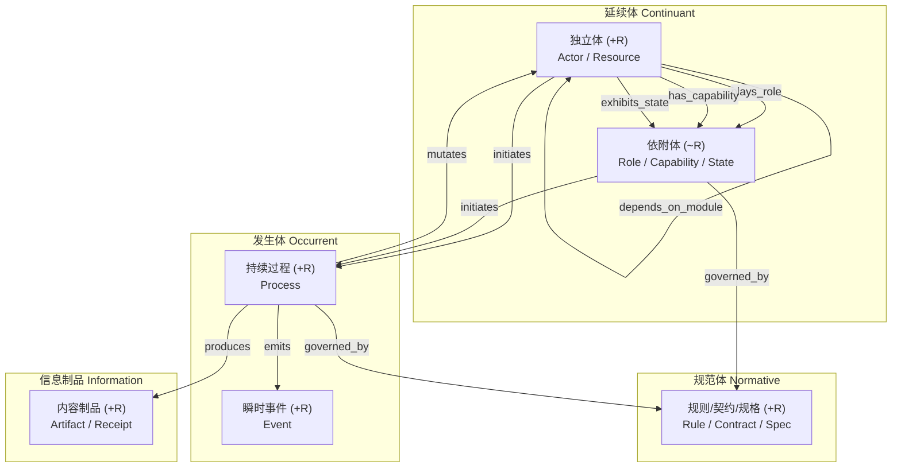

# `frago` Agent OS 操作型本体架构与设计手册

本目录（`src/frago/ontology/`）承载 `frago` Agent OS 的**操作型本体内核**。它以形式本体论的三轴正交公理、OntoClean 刚性约束、一等公民关系代数与契约式设计为理论地基，将 `frago` 五根业务支柱与全部 26 个子系统的概念收敛进单一原始数据模型 [`frago.json`](file:///home/yammi/repos/frago/src/frago/ontology/frago.json)，并在完全不侵入存量业务模块的前提下，提供动态类编译、三主线动能层运行时、跨会话 SPARQL 路径推理、多跳因果溯源与真实磁盘数据影子投影能力。

---

## 第一部分：本体论理论地基（源于最初探讨《产品内部概念的本体论构建》）

### 1.1 为什么要「正交」：从「蝴蝶与摩托车」看集合互斥与正交基向量的本质差异

在日常经验分类中，「蝴蝶」与「摩托车」是互斥的（$A \cap B = \emptyset$），但它们**绝不是正交的**（$A \not\perp B$）：
- 在本体论坐标系下，蝴蝶与摩托车落在完全相同的坐标点上——它们都是**延续体**（在任意时间切片上完整存在）、都是**独立实体**（不依附其他宿主而存在）、都是**刚性类**（`+R`，一旦失去该身份即不再是其自身）。
- 用互斥的经验名词做顶层分类，张成空间的能力为零。一旦业务引入「角色、状态、流程、规则」四个维度的组合（例如：当 $N$ 种资产充当 $M$ 种担保角色、触发 $K$ 种风控规则、进入 $P$ 种处置流程），传统面向对象继承或经验分类会产生笛卡尔积式的类爆炸：

$$\text{Complexity}_{\text{naive}} = O(N \times M \times K \times P)$$

- **正交本体基座**通过三条彼此独立的元属性坐标轴切分顶层超类。任何改变轴 X 上的取值都不约束轴 Y 上的取值，使系统概念总复杂度从乘法级降维成加法级：

$$\text{Complexity}_{\text{orthogonal}} = O(N + M + K + P)$$

任何复杂业务场景无需新增组合子类，而是表示为正交基向量在运行时的**图谱张量组合**（由一等公民关系边连接独立主体、上下文角色、规范规则与持续过程）。

---

### 1.2 三条正交坐标轴与四大互斥顶层象限

`frago` 本体元模型在根节点 [`OntologyEntity`](file:///home/yammi/repos/frago/src/frago/ontology/metamodel.py#L96-L154)（对应 `Thing`）之下，通过三条形式化正交公理切分出四个严格互斥的顶层象限：

| 正交坐标轴 | 形式化判别公理 | 核心追问 | 切分出的极值象限 |
|---|---|---|---|
| **1. 时间延展方式**（[`Mereotemporality`](file:///home/yammi/repos/frago/src/frago/ontology/metamodel.py#L43-L48)） | $\forall t(E(x,t) \to \text{WhollyPresent}(x,t))$ | 实体在任意时间切片 $t$ 上是否完整存在，还是必须在时间区间中按阶段展开？ | **延续体**（[`Continuant`](file:///home/yammi/repos/frago/src/frago/ontology/metamodel.py#L157-L162)，只有空间部分、无时间部分）$\perp$ **发生体**（[`Occurrent`](file:///home/yammi/repos/frago/src/frago/ontology/metamodel.py#L261-L266)，在时间流中展开、有时间阶段） |
| **2. 存在依赖性**（[`ExistentialDependence`](file:///home/yammi/repos/frago/src/frago/ontology/metamodel.py#L51-L56)） | $\Box(\forall t(E(x,t) \to \exists y(\text{InheresIn}(x,y,t))))$ | 实体能否脱离宿主独立存在，还是必须依附于某个承载主体与作用域？ | **独立延续体**（[`IndependentContinuant`](file:///home/yammi/repos/frago/src/frago/ontology/metamodel.py#L165-L185)：主体 [`Actor`](file:///home/yammi/repos/frago/src/frago/ontology/metamodel.py#L188-L193)、资源 [`Resource`](file:///home/yammi/repos/frago/src/frago/ontology/metamodel.py#L196-L201)）$\perp$ **依附延续体**（[`DependentContinuant`](file:///home/yammi/repos/frago/src/frago/ontology/metamodel.py#L204-L227)：角色 [`Role`](file:///home/yammi/repos/frago/src/frago/ontology/metamodel.py#L230-L235)、能力 [`Capability`](file:///home/yammi/repos/frago/src/frago/ontology/metamodel.py#L238-L243)、状态属性 [`QualityState`](file:///home/yammi/repos/frago/src/frago/ontology/metamodel.py#L246-L258)） |
| **3. 世界匹配方向**（[`DirectionOfFit`](file:///home/yammi/repos/frago/src/frago/ontology/metamodel.py#L59-L65)，Searle 意向性） | 客观实在 vs. 世界向规范看齐 vs. 符号向世界看齐 | 它是运行时的客观实在，还是要求实在服从它的规范契约，还是表征实在的符号制品？ | **实在体**（`Continuant` / `Occurrent`）$\perp$ **规范体**（[`NormativeEntity`](file:///home/yammi/repos/frago/src/frago/ontology/metamodel.py#L343-L370)：规则 [`RulePolicy`](file:///home/yammi/repos/frago/src/frago/ontology/metamodel.py#L373-L378)、契约 [`Contract`](file:///home/yammi/repos/frago/src/frago/ontology/metamodel.py#L381-L386)、规格 [`Specification`](file:///home/yammi/repos/frago/src/frago/ontology/metamodel.py#L389-L394)）$\perp$ **信息制品**（[`InformationEntity`](file:///home/yammi/repos/frago/src/frago/ontology/metamodel.py#L397-L421)） |

---

### 1.3 超类必须挂载的四条元公理（Meta-Axioms）

如果顶层超类只是一组空类名，本体就会退化为普通字典。`frago` 在 [`metamodel.py`](file:///home/yammi/repos/frago/src/frago/ontology/metamodel.py) 中通过 Python 元类钩子与构造校验器，将四条形式元公理焊死在四大超类上：

1. **同一性判据（`+I` Identity Criterion）**：决定两个实例何时代表同一个事物（[`canonical_id`](file:///home/yammi/repos/frago/src/frago/ontology/metamodel.py#L149-L153)）：
   - [`IndependentContinuant`](file:///home/yammi/repos/frago/src/frago/ontology/metamodel.py#L165-L185)（`Actor` / `Resource`）：由全局唯一 `uid` 标识，属性或端口改变不改变其身份。
   - [`DependentContinuant`](file:///home/yammi/repos/frago/src/frago/ontology/metamodel.py#L204-L227)（`Role` / `Capability` / `QualityState`）：由复合键 `dependent:{dependent_type}@bearer={bearer_id}#context={context_id}` 标识，绝不允许脱离宿主与上下文独立实例化（违反时抛出 [`IdentityCriterionError`](file:///home/yammi/repos/frago/src/frago/ontology/metamodel.py#L26-L27)）。
   - [`Event`](file:///home/yammi/repos/frago/src/frago/ontology/metamodel.py#L313-L340)：由发生时间戳 `occurred_at`、因果源标识 `causal_source_id` 与载荷哈希 `payload_hash` 的 SHA-256 因果指纹标识。
   - [`NormativeEntity`](file:///home/yammi/repos/frago/src/frago/ontology/metamodel.py#L343-L370)：由 `norm:{norm_id}@{semantic_version}` 标识。
   - [`InformationEntity`](file:///home/yammi/repos/frago/src/frago/ontology/metamodel.py#L397-L421)：由内容寻址哈希 `content_hash` 或 `artifact_uri` 标识。
2. **OntoClean 刚性约束（`+R` vs. `~R`）与「抽离上下文测试」**：
   - **刚性类（`+R` Rigid）**：实例在全生命周期内必然属于该类（如 `AgentKernel`、`VirtualDesktopStage`）。
   - **反刚性类（`~R` Anti-Rigid）**：实例仅在特定上下文或时间段内偶然扮演该类（如 `PrimarySchedulerRole`、`SubtaskWorkerRole`、`CallerZoneRole`）。
   - **铁律**：**反刚性类（`~R`）严禁作为刚性类（`+R`）的父类**。[`OntologyEntity.__init_subclass__`](file:///home/yammi/repos/frago/src/frago/ontology/metamodel.py#L112-L147) 在类定义期自动拦截任何把 `Actor` 继承自 `Role` 或跨象限混血的非法继承，当场抛出 [`OntoCleanViolationError`](file:///home/yammi/repos/frago/src/frago/ontology/metamodel.py#L32-L33)。
3. **可变性与底层异构存储原语对齐（Mutability & Storage Alignment）**：
   - `IndependentContinuant` → **状态存储（State Store）**：原地更新，版本号递增（`bump_version()`）。
   - `DependentContinuant` → **上下文槽位存储（Context Binding Store）**：随会话、请求或结对作用域生命周期挂载与卸载。
   - `Occurrent.Process` → **生命周期状态机引擎（Lifecycle Engine）**：受控状态跃迁（`transition_to()`），严禁逆向非法跳转。
   - `Occurrent.Event` → **追加日志（Append-Only Log）**：严格不可变，任何属性篡改尝试均抛出 [`MutabilityViolationError`](file:///home/yammi/repos/frago/src/frago/ontology/metamodel.py#L38-L39)。
   - `NormativeEntity` → **策略与契约注册表（Policy & Contract Registry）**：版本化不可变，带生效时间窗口 `valid_from` / `valid_until`。
   - `InformationEntity` → **内容寻址与多维召回引擎（CAS / Multi-Index Recall Engine）**：基于 `content_hash` 去重与跨层检索。
4. **关系定义域与值域护栏（Domain & Range Guardrails）**：
   - 跨象限连接边在 [`relations.py`](file:///home/yammi/repos/frago/src/frago/ontology/relations.py) 中强制校验源节点与目标节点的超类归属，从根源阻断「规则发起过程」或「事件扮演角色」等语义错乱。

---

### 1.4 业务概念向超类收敛的四步工程法

1. **第一步：动静分离（切分 `Continuant` 与 `Occurrent`）**——问「它有状态，还是它有开始与结束时间？」。例如「虚拟桌面舞台」是持久资源（`Continuant`），而「在舞台上执行一次录屏或推流」是持续过程（`Occurrent`）。
2. **第二步：抽离上下文测试（剥离 `Actor/Resource` 与 `Role`）**——问「如果把当前会话、HTTP 请求或结对房间撤掉，这个实体还存在吗？」。撤掉后依然存在的是 `AgentKernel` 或 `HumanPrincipal`（`+R`）；撤掉后立即消失的「主控 PA」「子任务 Worker」「主人调用方」「结对队友」全部剥离为 `Role`（`~R`）。
3. **第三步：业务守卫显式化（提炼 `NormativeEntity`）**——将散落在代码各处的隐式 `if-else` 权限与钩子条件，提炼为可版本化、可自省的 `RulePolicy`、`Contract` 与 `Specification`。
4. **第四步：单根继承本质，正交挂载切面**——每个领域类在分类树上只继承一个本质父类（`is-a`），横切能力（如配方的 `@export`/`@action`、Harness 的探针能力）一律建模为 `Capability` 或 `QualityState` 通过关系边挂载。

---

### 1.5 入参、签名与契约的三层同心圆防线

在 AI Agent 工具调用与跨进程编排场景下，调用方看不到函数内部源码。「入参」「签名」「契约」不是同义词，而是严格的一层包一层的同心圆防线：

$$\text{入参 (Parameters)} \subset \text{签名 (Signature)} \subset \text{契约 (Contract)}$$

| 维度 | 第 1 层：入参（Parameters） | 第 2 层：签名（[`ActionSignature`](file:///home/yammi/repos/frago/src/frago/ontology/contracts.py#L87-L133)） | 第 3 层：契约（[`OntologicalActionContract`](file:///home/yammi/repos/frago/src/frago/ontology/contracts.py#L152-L263)） |
|---|---|---|---|
| **包含范围** | 仅函数的输入槽位名列表 | 发起方定义域 `initiator_domain` + 目标值域 `target_range` + 入参类型映射 + 返回值类型 + 异常声明 | 完整签名 + 前置条件 `preconditions` + 后置条件 `postconditions` + 系统不变量 `invariants` + 副作用图谱声明 `side_effects` |
| **回答的问题** | 调用时需要传哪几个参数名？ | 接口长什么样？谁能对谁发起调用？类型如何对齐？ | 满足什么业务状态与权限前提才允许调？调完承诺产生什么状态变更与事件？ |
| **拦截的典型错误** | 漏传必填槽位或槽位名拼写错误 | 传入错误数据类型，或让 `Event` 发起动作（抛出 [`SignatureViolationError`](file:///home/yammi/repos/frago/src/frago/ontology/contracts.py#L25-L26)） | 签名 100% 合法，但子任务 Worker 试图套娃拉起新 Agent、或未获本轮人类授权回执就执行写操作（抛出 [`PreconditionViolationError`](file:///home/yammi/repos/frago/src/frago/ontology/contracts.py#L31-L32) / [`PostconditionViolationError`](file:///home/yammi/repos/frago/src/frago/ontology/contracts.py#L37-L38) / [`InvariantViolationError`](file:///home/yammi/repos/frago/src/frago/ontology/contracts.py#L43-L44)） |

---

### 1.6 区分「伪本体造词」与「真操作型本体」的四块照妖镜

计算机科学界曾长期批评把普通 ER 图或数据字典包装成「本体」的伪本体行为。`frago` 的本体内核严格按以下四项增量标准构建：

| 检验维度 | 传统数据库 ER Schema | 面向对象领域模型（OOP / DDD） | `frago` 操作型本体（Operational Ontology） |
|---|---|---|---|
| **1. 关系的地位** | 二等公民（外键或中间表，无代数公理） | 二等公民（对象内部单向引用字段） | **一等公民**（[`RelationSignature`](file:///home/yammi/repos/frago/src/frago/ontology/relations.py#L51-L82) 与 [`OntologyGraph`](file:///home/yammi/repos/frago/src/frago/ontology/relations.py#L100-L246)）：具备传递性、非对称性、反自反性、函数性校验及逆关系自动派生 |
| **2. 分类如何决定** | 静态落表（插进哪张表就是什么类型） | 显式构造（代码里硬编码 `new SubClass()`） | **公理驱动分类**（[`DefinedClass`](file:///home/yammi/repos/frago/src/frago/ontology/contracts.py#L50-L68)）：定义充要条件谓词，运行期由 [`OntologyGraph.classify()`](file:///home/yammi/repos/frago/src/frago/ontology/relations.py#L238-L246) 自动归类 |
| **3. 动作与规则的位置** | 散落在外部业务代码中，Schema 对行为无感知 | 方法死绑在单个类上，跨实体协同易变过程式泥球 | **动静正交（Kinetic Layer）**：[`OntologicalActionContract`](file:///home/yammi/repos/frago/src/frago/ontology/contracts.py#L152-L263) 作为独立规范体，通过三层同心圆防线与副作用声明挂载到实体图谱 |
| **4. 系统自省能力** | 仅能查表名与列类型 | 仅能反射函数签名，拿不到业务前置条件 | **全图谱自解释**（[`OntologyIntrospector`](file:///home/yammi/repos/frago/src/frago/ontology/introspection.py#L44-L216) 与 [`OntologyReasoner`](file:///home/yammi/repos/frago/src/frago/ontology/reasoning.py#L261-L476)）：支持 SPARQL 风格路径查询与跨会话多跳因果溯源 |

---

## 第二部分：`frago` Agent OS 操作型本体架构设计

### 2.1 [`frago.json`](file:///home/yammi/repos/frago/src/frago/ontology/frago.json) 的核心定位：驱动 Python 运行时的原始数据模型

[`src/frago/ontology/frago.json`](file:///home/yammi/repos/frago/src/frago/ontology/frago.json) 不是静态说明文档，而是驱动 `frago` 本体包构建 Python 类、关系签名与动作契约的**唯一原始数据源**：
- [`DomainClassRegistry`](file:///home/yammi/repos/frago/src/frago/ontology/registry.py#L71-L269) 在启动时直接读取 `frago.json`，将其中声明的全部 **63 个领域类**动态编译为强类型的 [`OntologyEntity`](file:///home/yammi/repos/frago/src/frago/ontology/metamodel.py#L96-L154) 子类，自动注入 `OntoClean` 刚性标记、状态机合法状态集、`QualityState` 允许取值集合以及 `Role`/`Capability` 宿主约束。
- [`build_relations_from_schema()`](file:///home/yammi/repos/frago/src/frago/ontology/relations.py#L294-L343) 直接从 `frago.json` 的 `relation_signatures` 构建全部 **10 条一等公民关系签名**及其逆关系。

---

### 2.2 四大顶层象限与跨象限关系总览图



---

### 2.3 三条核心建模主线

本会话确立并落地了 `frago` 本体架构的三条核心建模主线（实现在 [`runtime.py`](file:///home/yammi/repos/frago/src/frago/ontology/runtime.py)）：

#### 主线一：智能体拆五体（遵循 `agent-ontology-granularity` 约束）
大 `Agent` 类的属性与方法属于程序实现层，绝不能在业务本体层把「内核、终端底座、职责角色、会话过程、连接配置」塞进同一个类。[`decompose_agent_session()`](file:///home/yammi/repos/frago/src/frago/ontology/runtime.py#L96-L202) 将智能体拆解为五个生命周期彼此独立的正交实体，并通过图谱边连接：

| 拆解维度 | 本体类名 | 所属超类与刚性 | 唯一身份判据 | 关联关系边 |
|---|---|---|---|---|
| **1. 我是谁（内核身份）** | `AgentKernel` | `Actor`（`+R`） | `claude \| codex \| opencode \| agy \| coreagent` | 通过 `hosted_on_harness` 挂载于 `AgentHarness` |
| **2. 我挂在哪个载体上** | `AgentHarness` | `Resource`（`+R`） | `tmux_pane_target` 或 `kernel_subprocess_slot` | 通过 `has_capability` 挂载 `HarnessProbeCapability` |
| **3. 我在本场担什么职责** | `PrimarySchedulerRole` / `SubtaskWorkerRole` / `CompanionJudgeRole` | `Role`（`~R`） | `bearer_id + session_id + role_type` | 由 `AgentKernel` 通过 `plays_role` 动态扮演，随会话结束即卸载 |
| **4. 我在跑哪场对话/哪一轮** | `AgentSessionProcess` / `HarnessTurnProcess` | `Process`（`+R`） | `session_id` / `turn_run_uid` | 由角色通过 `initiates` 拉起，通过 `produces` 产出 `SessionTranscriptArtifact` |
| **5. 我用哪套供应商凭据** | `ApiProfile` | `Resource`（`+R`） | `profile_id` | 在 [`drive_agent_turn`](file:///home/yammi/repos/frago/src/frago/ontology/runtime.py#L223-L353) 中仅允许通过环境变量或 `profile_id` 注入，严禁明文出现在命令行 |

#### 主线二：长生命周期资源与运行态分离（遵循 `agent-os-instance-registry` 与 `agent-os-screen-ownership` 约束）
虚拟桌面（`agent_os` / `frago desktop`）在 [`DesktopStageLifecycleRuntime`](file:///home/yammi/repos/frago/src/frago/ontology/runtime.py#L384-L539) 中被严格拆分为持久资源身份与易失运行态：
- **持久身份层**：`VirtualDesktopStage`（`Resource`，`+R`），其 `content_id` 仅由 `instance_id` 计算 SHA-256 前 12 位（[`compute_desktop_content_id()`](file:///home/yammi/repos/frago/src/frago/ontology/runtime.py#L361-L364)），与动态分配的 broker 端口彻底解耦。
- **易失运行态层**：`DesktopInstanceRuntimeState`（`QualityState`，`~R`），取值为 `running | stopped | stale`，通过函数性关系 `exhibits_state` 挂载在舞台资源上。
- **核心不变量**：停止虚拟桌面只将 `DesktopInstanceRuntimeState` 切换为 `stopped`，**绝不删除或篡改 `VirtualDesktopStage` 的身份字段**（「没在跑」与「不存在」是两种截然不同的本体状态）；当桌面页上报的 `content_id` 与舞台身份不符时，[`control_desktop_stage`](file:///home/yammi/repos/frago/src/frago/ontology/runtime.py#L469-L539) 立即将其作为 `foreign_clients` 拦截并拒绝覆盖舞台视口布局。

#### 主线三：CLI 命令作为动能层动作契约（系统调用）
每一条 `frago` CLI 子命令在 [`CliActionRegistry`](file:///home/yammi/repos/frago/src/frago/ontology/runtime.py#L562-L674) 中具有双重本体投影：
- **静态视角**：它是规范体中的 [`CliCommandActionContract`](file:///home/yammi/repos/frago/src/frago/ontology/frago.json#L801-L810)（`NormativeEntity.Contract`，`+R`），声明了谁能调用（`initiator_domain`）、作用于哪类资源（`target_range`）以及三层同心圆防线。
- **动态视角**：当命令被敲下执行时，它拉起一个发生体 `Process`（如 `RecipeExecutionProcess`、`HarnessTurnProcess`、`ChannelIngestionProcess`），发出不可变 `Event`，并按契约修改目标 `Resource` 或产出 `InformationEntity`。

---

### 2.4 五根支柱、26 个子系统与 63 个领域类全景映射表

[`frago.json`](file:///home/yammi/repos/frago/src/frago/ontology/frago.json) 将 `src/frago/` 下全部 26 个子系统目录映射到 11 个超类路径下的 **63 个领域类**（含 `CallerZoneRole` 的 3 个子角色与 `TeamPeerRole` 的 2 个子角色）：

#### （1）独立延续体 · 主体（`Continuant.IndependentContinuant.Actor`，共 2 类，刚性 `+R`）

| 类名 `class_id` | 所属支柱 | 同一性判据 | 映射代码位置 | 核心语义 |
|---|---|---|---|---|
| `AgentKernel` | 底座与边界 | `claude \| codex \| opencode \| agy \| coreagent` | `session/models.py`、`agent_driver/`、`bin/` | 外部或内置智能体内核本体，不内嵌会话状态与 Tmux 句柄 |
| `HumanPrincipal` | 跨层底座 | `local_machine_owner \| user_account_id \| team_member_uuid \| anonymous_peer` | `server/identity.py`、`team/state.py`、`cli/user_commands.py` | 与 `frago` 交互的自然人主体（本机主人、登录账号、结对成员、匿名访问者） |

#### （2）独立延续体 · 资源（`Continuant.IndependentContinuant.Resource`，共 13 类，刚性 `+R`）

| 类名 `class_id` | 所属支柱 | 同一性判据 | 映射代码位置 | 核心语义 |
|---|---|---|---|---|
| `AgentHarness` | 5. 边界 | `harness_id (tmux_pane \| subprocess_slot)` | `agent_driver/tmux_session.py`、`kernel_backend.py` | 承载 `AgentKernel` 运行的物理底座（Tmux 槽位或无屏子进程槽位） |
| `RecipeModule` | 4. 配方 | `recipe_name` | `recipes/registry.py`、`recipes/metadata.py` | 跑通一次后固化成确定性代码的工具模块（`atomic` / `workflow`） |
| `SkillPackageResource` | 跨层底座 | `skill_slug` | `skills/`、`resources/skills/`、`cli/skill_commands.py` | 跨内核可挂载的技能包资源（`SKILL.md` 与脚本资产） |
| `DataSlot` | 3. 记忆与召回 | `canonical_slot_path` | `recipes/app_state.py`、`server/identity.py`、`context/`、`files/` | 受隔离保护的数据槽位（`app-state`、`users/<id>/`、`~/.frago/data/<subject>/`） |
| `BrowserTabGroup` | 2. 手和眼 | `group_name` | `browser/`、`chrome/`、`cdp/`、`cli/browser_commands.py` | 受控浏览器中的真实标签组资源（单组上限 5 个标签页） |
| `VirtualDesktopStage` | 2. 手和眼 | `composite(instance_id, content_id)` | `desktop/`、`cli/desktop_commands.py` | 可脚本驱动、录屏与配音的虚拟桌面舞台独立资源（身份与端口分离） |
| `BuiltinDeliveryApp` | 2. 手和眼 | `app_name` | `cli/apps_commands.py` | 内置交付能力实体（`frago apps`） |
| `ContentViewerSurface` | 2. 手和眼 | `viewer_content_id` | `viewer/`、`cli/view_command.py` | 内容查看器资源（区分本地文件与配方产物的双世界标识） |
| `ApiProfile` | 人面与跨层底座 | `profile_id` | `init/profile_manager.py`、`cli/profile_commands.py` | 模型供应商连接凭据与端点配置（`~/.frago/profiles.json`） |
| `MachineRuntimeConfig` | 人面与跨层底座 | `machine_fingerprint` | `config/`、`init/` | 本机设备级运行配置（`~/.frago/config.json`） |
| `KnowledgeDomain` | 3. 记忆与召回 | `domain_name` | `def_/registry.py`、`cli/def_commands.py` | `frago def` 注册的结构化知识域（`~/.frago/books/<domain>/`） |
| `CommunicationChannel` | 5. 边界 | `feishu \| slack \| email \| team_relay` | `team/relay.py`、`cli/channel_commands.py`、`cli/reply_command.py` | 外部进件与回传渠道或结对中继服务器 |
| `RemoteFragoNode` | 5. 边界 | `remote_node_name` | `cli/remote_commands.py` | 远端服务器上的另一台 `frago` 实例节点（`frago remote`） |

#### （3）依附延续体 · 角色（`Continuant.DependentContinuant.Role`，共 5 主类 + 5 子角色 = 10 类，反刚性 `~R`）

| 类名 `class_id` | 宿主 `bearer_type` | 作用域 `context_type` | 子角色 `subroles` | 核心语义 |
|---|---|---|---|---|
| `PrimarySchedulerRole` | `AgentKernel` | `AgentSessionProcess` | — | 主控调度角色（PA）：拆解任务、接管自然语言定时与外部进件、调度子任务与配方 |
| `SubtaskWorkerRole` | `AgentKernel` | `AgentSessionProcess` | — | 子任务执行角色（Worker）：完成有界子任务并交回产物，禁止套娃拉起下级会话 |
| `CompanionJudgeRole` | `AgentKernel` | `HookEvaluationProcess` | — | 会话伴侣裁决角色（LightAgent）：在提交前、收尾时、否决前与命令审计时执行判读 |
| `CallerZoneRole` | `HumanPrincipal \| AgentKernel` | `HttpRequestProcess` | `OwnerCallerRole`、`SignedInVisitorRole`、`AnonymousVisitorRole` | 请求方在单次访问上下文中的权限角色（主人身份由请求来源动态赋予） |
| `TeamPeerRole` | `HumanPrincipal \| AgentKernel` | `TeamPairingScope` | `InitiatorSideARole`、`JoinerSideBRole` | 结对协作中的 A 侧/B 侧队友角色，随连接码绑定生效、随解绑消亡 |

#### （4）依附延续体 · 能力与状态属性（`Capability` 4 类 + `QualityState` 3 类，反刚性 `~R`）

| 分类 | 类名 `class_id` | 宿主 `bearer_type` | 允许取值 / 能力项 | 核心语义 |
|---|---|---|---|---|
| `Capability` | `RecipeModeCapability` | `RecipeModule` | `export_readonly`、`action_triggerable`、`owner_internal` | 配方方法通过 `@export` / `@action` 声明的访问能力切面 |
| `Capability` | `HarnessProbeCapability` | `AgentHarness` | `ready_signal`、`done_signal`、`transcript_completion_probe`、`exception_modal_handler` | Harness 对被驱动 Agent 的屏面匹配、JSONL 权威完成度探针与弹窗消解能力 |
| `Capability` | `ExternalCommandCapability` | `RecipeModule` | `uses_commands`、`uses_frago_cli` | 配方声明调用外部系统命令或平台 CLI 的受控越界能力切面 |
| `Capability` | `GlobalHotkeyCapability` | `MachineRuntimeConfig` | 全局热键绑定 | 桌面端全局快捷键唤醒能力切面（`hotkey/`） |
| `QualityState` | `SecurityZoneState` | `CallerZoneRole` | `local`、`public`、`identity`、`token` | 安全网关对每个请求判定的唯一互斥安全区状态（`server/security.py`） |
| `QualityState` | `SessionOriginState` | `AgentSessionProcess` | `terminal`、`web`、`worker`、`unknown` | 会话实例的发起源状态（决定工作台左栏过滤与回收归属） |
| `QualityState` | `DesktopInstanceRuntimeState` | `VirtualDesktopStage` | `running`、`stopped`、`stale` | 虚拟桌面实例的易失运行态属性层，随启停覆写、绝不抹除宿主资源身份 |

#### （5）发生体 · 持续过程（`Occurrent.Process`，共 11 类，刚性 `+R`，时间区间 `interval`）

| 类名 `class_id` | 所属支柱 | 状态机状态集 `states` | 映射代码位置 | 核心语义 |
|---|---|---|---|---|
| `AgentSessionProcess` | 3. 记忆与召回 / 5. 边界 | `running`、`completed`、`error`、`cancelled` | `session/models.py`、`session/storage.py` | 一场有起止时间的 Agent 会话过程，产出 `SessionTranscriptArtifact` |
| `HarnessTurnProcess` | 5. 边界 | `submitting`、`streaming`、`verifying_completion`、`ok`、`needs_input`、`timeout`、`error` | `agent_driver/tmux_session.py`、`kernel_backend.py` | Harness 驱动 Agent 执行单轮问答/干活的原子过程 |
| `RecipeExecutionProcess` | 4. 配方 | `queued`、`isolating_view`、`running`、`succeeded`、`failed` | `recipes/runner.py`、`recipes/isolation.py` | 配方在受限文件视图中绑定特定用户身份与数据槽位的一次运行过程 |
| `SupervisedDaemonProcess` | 4. 配方 | `starting`、`running`、`restarting`、`stopped`、`failed` | `recipes/background.py`、`cli/daemon_commands.py` | 声明了 `daemon: true` 的常驻守护配方过程（`frago daemon`） |
| `MarketInstallProcess` | 4. 配方 | 默认状态机 | `recipes/installer.py` | 从配方市场搜索、下载、校验并安装配方模块到本地的流转过程 |
| `RunTransactionProcess` | 3. 记忆与召回 | 默认状态机 | `run/manager.py`、`run/models.py` | 围绕单次业务事务建立的运行实例过程（`frago run`） |
| `ChannelIngestionProcess` | 5. 边界 | 默认状态机 | `cli/channel_commands.py`、`cli/reply_command.py` | 从外部渠道摄取任务、交主控处理并通过 `frago reply` 原路回传的过程 |
| `RemoteTaskDispatchProcess` | 5. 边界 | 默认状态机 | `cli/remote_commands.py` | 向远端 `RemoteFragoNode` 下发结果导向型任务书并轮询状态的过程 |
| `TeamSyncProcess` | 5. 边界 | 默认状态机 | `team/sync.py`、`team/live.py` | 结对会话向中继增量推送轨迹并拉取对侧请求的过程 |
| `HomeSyncProcess` | 跨层底座 | 默认状态机 | `tools/sync_repo.py`、`cloud/` | `~/.frago` 家目录跨设备 Git 同步与冲突自动消解过程 |
| `FileSystemWatchProcess` | 跨层底座 | 默认状态机 | `watcher/` | 本地会话目录与配置文件变更监听过程 |

#### （6）发生体 · 瞬时事件（`Occurrent.Event`，共 6 类，刚性 `+R`，追加不可变 `append_only_immutable`）

| 类名 `class_id` | 所属支柱 | 事件细分类型 | 映射代码位置 | 核心语义 |
|---|---|---|---|---|
| `HookLifecycleEvent` | 1. 会话伴侣 | `SessionStart`、`UserPromptSubmit`、`PreToolUse`、`PostToolUse`、`Stop` | `cli/agy_hook.py`、`.claude/docs/hook-system-frago-core.md` | Agent 生命周期中触发会话伴侣介入的瞬时事件 |
| `SessionStepEvent` | 3. 记忆与召回 | `user`、`assistant`、`tool_call`、`tool_result`、`system` | `session/models.py`、`session/unified_record.py` | 会话过程中不可篡改的单步事实记录 |
| `CommandGrantAuditedEvent` | 4. 配方 | 命令首次放行审计 | `recipes/command_grants.py` | 配方首次调用 `uses_commands` 外部命令经 CoreAgent 审计写入 `grants.json` 的事件 |
| `ScheduledTriggerEvent` | 5. 边界 | `cron_fired`、`overdue_alert`、`change_notification` | `recipes/schedule.py`、`cli/schedule_commands.py` | 时钟按 cron 触发定时任务、逾期告警或变更通知的瞬时事件 |
| `ChannelMessageEvent` | 5. 边界 | `inbound_task_received`、`outbound_reply_delivered` | `cli/channel_commands.py`、`cli/reply_command.py` | 外部渠道进件到达与 `frago reply` 原路回传完成的瞬时事件 |
| `TelemetryEvent` | 跨层底座 | 运行期遥测指标 | `telemetry/` | 系统运行期采集的遥测与性能指标瞬时事件 |

#### （7）规范体（`NormativeEntity`，共 11 类，刚性 `+R`，版本化不可变 `versioned_immutable`）

| 子类分支 | 类名 `class_id` | 所属支柱 | 映射代码位置 | 核心语义 |
|---|---|---|---|---|
| `RulePolicy` | `HookInjectionRule` | 1. 会话伴侣 | `resources/hook/`、`cli/hook_rules_commands.py` | 按事件与条件匹配向 Agent 上下文精准注入 `book` 速记的静态规则 |
| `RulePolicy` | `StopGatePolicy` | 1. 会话伴侣 | `~/.frago/hook/stop-signals.json`、`stop.md` | 收尾闸门信号表与 LightAgent 判读规范（拦截过早收尾、强制出卡） |
| `RulePolicy` | `RecipeExposurePolicy` | 4. 配方 | `recipes/publish.py`、`server/routes/app_pages.py` | 配方页面开放策略（正交裁决谁能打开、从哪个数据根读、允许触发哪些 `@action`） |
| `RulePolicy` | `TeamPairingSecurityPolicy` | 5. 边界 | `team/state.py` | 结对协作三档安全策略（只读请求、改动请求、绝对红线请求） |
| `RulePolicy` | `SyncConflictPolicy` | 跨层底座 | `tools/sync_repo.py`、`frago-home-gitignore.template` | 家目录多设备同步边界与冲突自动裁决策略 |
| `RulePolicy` | `ModuleImportBoundaryRule` | 跨层底座 | `.importlinter`、`.claude/docs/architecture-north-star.md` | 架构分层依赖契约 |
| `Contract` | `RecipeModuleContract` | 4. 配方 | `recipes/contract.py`、`recipes/metadata.py` | 配方的声明式模块契约（输入输出签名、`shares` 与 `reads_common` 双向握手、`uses_commands`） |
| `Contract` | `CliCommandActionContract` | 跨层底座 | `cli/main.py`、`cli/commands.py` | `frago` CLI 系统调用契约 |
| `Specification` | `ScheduleRuleSpec` | 5. 边界 | `recipes/schedule.py`、`cli/schedule_commands.py` | 定时任务规格定义（cron、直跑命令/直跑配方/自然语言交主控、`--notify-on change`） |
| `Specification` | `RunDomainDictSpec` | 3. 记忆与召回 | `run/domain_dict.py` | 运行事务领域词典规格（任务描述到标准知识域的聚类映射规则） |
| `Specification` | `AutostartServiceSpec` | 人面与跨层底座 | `autostart/`、`cli/autostart_command.py` | 跨平台开机自启服务规格定义 |

#### （8）信息制品（`InformationEntity`，共 8 类，刚性 `+R`，内容寻址或只追加）

| 类名 `class_id` | 所属支柱 | 同一性判据 | 映射代码位置 | 核心语义 |
|---|---|---|---|---|
| `BookTopicDocument` | 1. 会话伴侣 | `topic_slug` | `resources/book/`、`cli/book_commands.py` | `frago book` 中的行为准则与操作手册正文 |
| `DefKnowledgeEntry` | 3. 记忆与召回 | `composite(domain_name, doc_name)` | `def_/query_engine.py`、`def_/schema_validator.py` | 结论层召回入口（`frago <domain> find/save`）中的结构化知识条目 |
| `ContextRecallIndex` | 3. 记忆与召回 | `data_subject_slug_path` | `context/`、`cli/context_commands.py` | 产物层召回入口（`frago context data:<关键词>`）的位置索引制品 |
| `SessionTranscriptArtifact` | 3. 记忆与召回 | `session_id` | `session/storage.py`、`session/search.py` | 过程层召回入口（`frago session search`）背后的双库备份会话轨迹文件 |
| `TokenUsageLedger` | 3. 记忆与召回 | `composite(date, agent_family, model)` | `session/token_calendar.py`、`session/usage_tick.py` | 跨内核会话 Token 消耗日历与用量统计账本制品 |
| `TodoHandoffArtifact` | 3. 记忆与召回 | `todo_id` | `todo/store.py`、`cli/todo_commands.py` | 跨会话交接单制品（自动关联历经的 `sessions` 列表，丢弃时必填 `drop_reason`） |
| `MarketPackageArtifact` | 4. 配方 | `composite(recipe_name, version)` | `recipes/installer.py`、`community-recipes/` | 配方市场（`frago market`）中可检索与版本化分发的归档制品 |
| `HumanDecisionReceipt` | 1. 会话伴侣 / 跨层底座 | `decision_message_uuid` | `client/` | 人类点击卡片产生的 `【answer】` 授权回执，其 `effect` 原文是本轮合法改变状态的唯一授权范围 |

---

### 2.5 十条一等公民关系签名表（[`relations.py`](file:///home/yammi/repos/frago/src/frago/ontology/relations.py)）

| 正向谓词 `name` | 定义域 `domain` | 值域 `range` | 逆谓词 `inverse` | 代数公理 `algebraic_properties` | 业务语义 |
|---|---|---|---|---|---|
| `plays_role` | `IndependentContinuant` | `Role` | `borne_by` | `asymmetric`、`irreflexive` | 刚性主体或资源在特定作用域中动态挂载反刚性角色 |
| `has_capability` | `IndependentContinuant` | `Capability` | `capability_of` | `asymmetric` | 主体或资源声明其可被调用的能力切面 |
| `exhibits_state` | `Continuant` | `QualityState` | `state_of` | `functional` | 延续体在当前时间切片呈现唯一函数性状态或安全区属性 |
| `hosted_on_harness` | `Actor` | `Resource` | `hosts_actor` | `asymmetric` | `AgentKernel` 挂载于具体 `AgentHarness` 之上运行 |
| `initiates` | `Actor \| Role` | `Process` | `initiated_by` | `asymmetric` | 主体或角色拉起一个持续过程 |
| `governed_by` | `Process \| Role \| NormativeEntity` | `NormativeEntity` | `governs` | `asymmetric` | 过程、角色或动作受规范体约束 |
| `mutates` | `Process \| NormativeEntity` | `IndependentContinuant` | `mutated_by` | `asymmetric` | 过程或动作修改目标独立延续体的状态槽位 |
| `emits` | `Process` | `Event` | `emitted_by` | `asymmetric`、`irreflexive` | 持续过程在时间点上发射不可变的瞬时事件 |
| `produces` | `Process` | `InformationEntity` | `produced_by` | `asymmetric` | 持续过程产出信息制品 |
| `depends_on_module` | `Resource \| NormativeEntity` | `Resource \| NormativeEntity` | `depended_on_by` | `transitive`、`irreflexive` | 模块或配方间的有向依赖，自动计算传递闭包并阻断循环依赖 |

---

### 2.6 四个公理驱动动态分类（[`BUILTIN_DEFINED_CLASSES`](file:///home/yammi/repos/frago/src/frago/ontology/contracts.py#L345-L370)）

无需硬编码子类，[`OntologyGraph.classify()`](file:///home/yammi/repos/frago/src/frago/ontology/relations.py#L238-L246) 根据实体在图谱中的属性与关系边动态判定是否属于以下定义类：

1. **`TrustedOwnerRequest`**（[`is_trusted_owner_request`](file:///home/yammi/repos/frago/src/frago/ontology/contracts.py#L271-L285)）：凡是扮演 `CallerZoneRole` 且通过 `exhibits_state` 关联 `SecurityZoneState in {'local', 'token'}` 的调用方，自动归类为具有主人权限的请求。
2. **`PublicExposableRecipe`**（[`is_public_exposable_recipe`](file:///home/yammi/repos/frago/src/frago/ontology/contracts.py#L288-L306)）：凡是属于 `RecipeModule` 且未挂载 `action_triggerable` 写能力切面的配方，才允许挂载 `--public` 匿名访问策略。
3. **`VerifiedTeammateInstruction`**（[`is_verified_teammate_instruction`](file:///home/yammi/repos/frago/src/frago/ontology/contracts.py#L309-L326)）：凡是带 `【frago team】` 前缀且通过中继消息核实的 `SessionStepEvent`，自动归类为受 `TeamPairingSecurityPolicy` 三档约束的结对队友请求，严禁当成本机主人指令。
4. **`DirectExecutableSchedule`**（[`is_direct_executable_schedule`](file:///home/yammi/repos/frago/src/frago/ontology/contracts.py#L329-L342)）：凡是目标形态为 `command:` 或 `recipe:` 的 `ScheduleRuleSpec`，自动归类为由调度器零 Token 直接执行的定时任务，不经过主控 PA。

---

### 2.7 五大核心动能层动作契约（[`runtime.py`](file:///home/yammi/repos/frago/src/frago/ontology/runtime.py)）

| 动作契约 `action_id` | 发起方定义域 `initiator_domain` | 目标值域 `target_range` | 核心前置条件与不变量护栏 |
|---|---|---|---|
| `drive_agent_turn` | `PrimarySchedulerRole \| HumanPrincipal` | `AgentHarness` | 严禁 `SubtaskWorkerRole` 套娃发起；`ApiProfile` 密钥严禁拼入命令行；遇到 `_AUTH_WALL` 或 0 字符异常完成强制降级为 `needs_input` 或 `error`，严禁伪报 `ok` |
| `control_desktop_stage` | `AgentKernel \| HumanPrincipal \| PrimarySchedulerRole` | `VirtualDesktopStage` | 强制校验 `content_id == sha256(instance_id)[:12]`；拒绝 `content_id` 不匹配的 `foreign_clients` 覆盖布局；`stop` 仅改运行态为 `stopped`、保留注册表身份 |
| `execute_recipe_mode` | `CallerZoneRole \| AgentKernel` | `RecipeModule` | 访客调用 `@action` 必须经 `RecipeExposurePolicy` 显式授权；`reads_common` 必须通过目标配方 `shares` 双向握手；`uses_commands` 必须具备 `CommandGrantAuditedEvent`；`@export` 严禁写数据槽位 |
| `execute_state_mutating_operation` | `AgentKernel` | `Resource \| NormativeEntity` | 改状态动作必须绑定当轮明示指令或 `HumanDecisionReceipt`（且操作与目标落在 `effect` 字面范围内）；结对队友请求在 `change == 'ask'` 时必须先获本机主人回执；红线操作无条件拒绝 |
| `reply_to_inbound_channel` | `PrimarySchedulerRole \| AgentKernel` | `CommunicationChannel` | 回传渠道 `channel_id` 必须与进件消息来源渠道严格一致；回传正文严禁包含密钥或私钥字符串 |

---

## 第三部分：`src/frago/ontology/` 模块职责与使用指南

### 3.1 目录文件架构与职责矩阵

本包严格遵守零业务侵入原则（仅依赖 Python 标准库与包内模块，不反向导入任何存量业务目录）：

| 文件路径 | 核心类与函数 | 模块职责说明 |
|---|---|---|
| [`frago.json`](file:///home/yammi/repos/frago/src/frago/ontology/frago.json) | 3 条正交轴、4 大超类、10 条关系、63 个领域类、4 个定义类、5 个动作契约 | `frago` Agent OS 操作型本体的唯一原始数据模型（v1.1.0） |
| [`metamodel.py`](file:///home/yammi/repos/frago/src/frago/ontology/metamodel.py) | [`OntologyEntity`](file:///home/yammi/repos/frago/src/frago/ontology/metamodel.py#L96-L154)、[`Continuant`](file:///home/yammi/repos/frago/src/frago/ontology/metamodel.py#L157-L162)、[`Occurrent`](file:///home/yammi/repos/frago/src/frago/ontology/metamodel.py#L261-L266)、[`NormativeEntity`](file:///home/yammi/repos/frago/src/frago/ontology/metamodel.py#L343-L370)、[`InformationEntity`](file:///home/yammi/repos/frago/src/frago/ontology/metamodel.py#L397-L421) | 四大超类、OntoClean 刚性继承校验器、同一性判据、状态机跃迁与不可变护栏 |
| [`relations.py`](file:///home/yammi/repos/frago/src/frago/ontology/relations.py) | [`RelationSignature`](file:///home/yammi/repos/frago/src/frago/ontology/relations.py#L51-L82)、[`OntologyGraph`](file:///home/yammi/repos/frago/src/frago/ontology/relations.py#L100-L246)、[`build_relations_from_schema()`](file:///home/yammi/repos/frago/src/frago/ontology/relations.py#L294-L343) | 一等公民关系签名、定义域/值域检查、逆关系自动派生、函数性/非对称性/反自反性/传递闭包图谱引擎 |
| [`contracts.py`](file:///home/yammi/repos/frago/src/frago/ontology/contracts.py) | [`DefinedClass`](file:///home/yammi/repos/frago/src/frago/ontology/contracts.py#L50-L68)、[`ActionSignature`](file:///home/yammi/repos/frago/src/frago/ontology/contracts.py#L87-L133)、[`OntologicalActionContract`](file:///home/yammi/repos/frago/src/frago/ontology/contracts.py#L152-L263)、[`@ontological_action`](file:///home/yammi/repos/frago/src/frago/ontology/contracts.py#L238-L263) | 公理驱动分类器与「入参 ⊂ 签名 ⊂ 契约」三层同心圆防线执行器 |
| [`introspection.py`](file:///home/yammi/repos/frago/src/frago/ontology/introspection.py) | [`OntologyIntrospector`](file:///home/yammi/repos/frago/src/frago/ontology/introspection.py#L44-L216)、[`load_ontology_schema()`](file:///home/yammi/repos/frago/src/frago/ontology/introspection.py#L30-L41) | 全图谱自省器：完整性校验、按支柱/超类/代码路径反查本体类、查询主体可执行动作契约 |
| [`registry.py`](file:///home/yammi/repos/frago/src/frago/ontology/registry.py) | [`DomainClassRegistry`](file:///home/yammi/repos/frago/src/frago/ontology/registry.py#L71-L269)、[`DEFAULT_DOMAIN_REGISTRY`](file:///home/yammi/repos/frago/src/frago/ontology/registry.py#L272) | 动态领域类编译器：将 `frago.json` 中的 63 个领域类编译为受 OntoClean 约束的 Python 子类 |
| [`runtime.py`](file:///home/yammi/repos/frago/src/frago/ontology/runtime.py) | [`AgentTurnRuntime`](file:///home/yammi/repos/frago/src/frago/ontology/runtime.py#L223-L353)、[`DesktopStageLifecycleRuntime`](file:///home/yammi/repos/frago/src/frago/ontology/runtime.py#L384-L539)、[`CliActionRegistry`](file:///home/yammi/repos/frago/src/frago/ontology/runtime.py#L562-L674)、[`RecipeAndBoundaryRuntime`](file:///home/yammi/repos/frago/src/frago/ontology/runtime.py#L682-L923) | 三条核心建模主线与五大动作契约的零侵入运行时沙盒 |
| [`reasoning.py`](file:///home/yammi/repos/frago/src/frago/ontology/reasoning.py) | [`OntologyReasoner`](file:///home/yammi/repos/frago/src/frago/ontology/reasoning.py#L261-L476)、[`SparqlQuery`](file:///home/yammi/repos/frago/src/frago/ontology/reasoning.py#L229-L258)、[`serialize_graph_jsonl()`](file:///home/yammi/repos/frago/src/frago/ontology/reasoning.py#L194-L206)、[`merge_graph_snapshots()`](file:///home/yammi/repos/frago/src/frago/ontology/reasoning.py#L220-L226) | 跨会话 JSONL 图谱快照序列化、SPARQL 风格属性路径查询与多跳因果溯源引擎 |
| [`projectors.py`](file:///home/yammi/repos/frago/src/frago/ontology/projectors.py) | [`FivePillarShadowProjector`](file:///home/yammi/repos/frago/src/frago/ontology/projectors.py#L844-L978) 及 14 个子系统投影函数 | 真实磁盘 JSON 字典（会话、虚拟桌面、配方、钩子、待办、知识域、结对、安全区等）到本体图谱的零侵入影子投影器 |

---

### 3.2 快速上手代码示例

#### （1）通过 `DomainClassRegistry` 动态实例化 `frago.json` 领域类与校验公理

```python
from frago.ontology import DEFAULT_DOMAIN_REGISTRY, OntologyIntrospector

# 1. 全图谱完整性校验（0 项问题）
introspector = OntologyIntrospector()
assert introspector.validate_schema_integrity() == []

# 2. 直接按 frago.json 中的 class_id 构造强类型本体实例
kernel = DEFAULT_DOMAIN_REGISTRY.create("AgentKernel", uid="claude")
role = DEFAULT_DOMAIN_REGISTRY.create(
    "PrimarySchedulerRole",
    bearer_id=kernel.canonical_id,
    context_id="sess-001",
)
```

#### （2）真实磁盘 JSON 零侵入投影、SPARQL 路径查询与多跳因果溯源

```python
from frago.ontology import FivePillarShadowProjector, OntologyReasoner, SparqlQuery, TriplePattern

projector = FivePillarShadowProjector()
projector.project_session({
    "session_id": "sess-main",
    "agent_type": "claude",
    "role": "PrimarySchedulerRole",
    "origin": "web",
    "status": "running",
    "steps": [{"step_index": 1, "type": "user", "content": "构建本体文档"}],
})
projector.project_todo({
    "id": "todo-doc",
    "title": "落实本体架构文档",
    "status": "doing",
    "what": "整理探讨与本会话设计",
    "current": "编写 README.md",
    "next_step": "跑通单测",
    "done_when": "文档落盘且单测全绿",
    "sessions": ["sess-main"],
})

reasoner = OntologyReasoner(projector.graph)

# SPARQL 风格多跳属性路径查询：查找哪个 AgentKernel 通过扮演角色发起会话并产出了交接单
rows = reasoner.query(
    SparqlQuery(
        select=("?actor", "?todo"),
        where=(
            TriplePattern("?actor", "plays_role/initiates/produces", "?todo"),
        ),
        type_filters={"?todo": "TodoHandoffArtifact"},
    )
)

# 逆向多跳因果溯源：从交接单制品一路追查到发起会话的智能体内核、终端底座与治理规则
lineage = reasoner.trace_causal_lineage("info:TodoHandoffArtifact:todo://todo-doc")
```

---

### 3.3 验证与自检命令

在仓库根目录通过 `uv run` 执行单元测试、类型检查与代码风格校验：

```bash
# 运行操作型本体全量单元测试（覆盖四大超类公理、关系代数、三条建模主线、影子投影器与跨会话推理）
uv run pytest tests/unit/ontology/test_ontology_kernel.py -q --no-cov

# 静态类型检查与代码规范检查
uv run mypy src/frago/ontology tests/unit/ontology/test_ontology_kernel.py
uv run ruff check src/frago/ontology tests/unit/ontology/test_ontology_kernel.py
```
